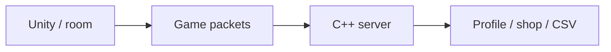

# Slap Squad — Multiplayer Server

[English](README.md) · [Korean](README.ko.md) · [Japanese](README.ja.md)

**C++ · Winsock · C# · Unity** · チーム開発

[開発事例を見る](https://ysl-ryudo.github.io/ja/work/bnb/) · [Portfolio](https://ysl-ryudo.github.io/ja/)

**2025.03 - 2026.02 · 8名：プログラマー2名、グラフィック6名**

サーバー・ネットワーク連携・ショップとプロフィール実装

Slap Squadチームプロジェクト向けWindows C++/Winsockサーバーです。アカウント、ルーム、ゲームパケット、ショップ・報酬フローを扱います。

## 取り組んだ課題

ルーム、ゲーム内操作、報酬、購入をクライアント・サーバー間で連携させる必要がありました。その実装から、獲得報酬に対してアイテム価格をどう設定するかという疑問が生まれました。

## 担当した実装と設計

パケット・ゲーム連携、ルームリーダー・水風船更新、ショップ・プロフィール処理を担当しました。別のCISC-W研究では仮想プレイヤーの行動を用い、固定価格と需要連動政策を比較しました。

### 実装概要 · 概念フロー

### 開発デモ動画

- [Slap Squad · OFY Studio](https://www.youtube.com/watch?v=1LMGsY_qY_8)
- [Early development demo](https://www.youtube.com/watch?v=MI5NtNU9eP8)

撮影時点のプロジェクトデモです。ゲーム内での担当作業は以下の担当範囲で示します。

## 担当した内容

- サーバーパケット処理とUnityゲーム連携を担当しました。
- ショップパケット、プロフィール情報処理、アイテム・アイコン解析を実装・修正しました。
- 関連するCISC-W 2025のシミュレーション研究で、報酬の蓄積とアイテム価格を分析しました。

## 貢献の根拠

- [Shop packets / 상점 패킷 / ショップパケット](https://github.com/YSL-RyuDo/BnBServer/commit/e41da66566252a105da68d98087198e632c0e9b7)
- [Profile / 프로필 / プロフィール](https://github.com/YSL-RyuDo/BnBServer/commit/37d6db7917815de40823af132aac8c31ed302a87)
- [Icon parsing / 아이콘 파싱 / アイコン解析](https://github.com/YSL-RyuDo/BnBServer/commit/c834f97f91bd8aaf62fe6bc2c7a2c29ea610ed9e)

コミットは記載した変更の根拠であり、貢献率の点数ではありません。外部素材・チームメンバーの貢献は区別します。

## 実行・コードの確認

Windows C++ワークロードを備えたVisual Studioで[TeamOFYServer.sln](TeamOFYServer.sln)を開いてください。構成・データパス・依存関係・接続設定を確認し、対応するクライアントを起動します。既存アカウントデータは維持してください。

[Slap Squad](https://github.com/YSL-RyuDo/BNB)

## 開発・検証範囲

接続ごとのスレッドとCSVベースのデータを使う学習・チームゲーム用サーバーです。大規模サービス性能の検証は主張しません。研究は価格政策の比較であり、実験した動的政策の本番導入は主張しません。論文と背景説明はSlap Squadクライアント側にまとめています。

## 実装の確認方法

クライアントとサーバーの本人作成コミットを確認し、論文は別の実験として読めます。サーバーは接続ごとのスレッドとCSVを使用し、一部のワールド判断はルームリーダーの入力を受け取ります。

## 開発から研究・発表へ

CNN価格政策研究を「データで設計するゲーム経済」として発表。その後、研究を補完してCISC-W 2025のポスター発表につなげました。

[2025 I2P-CON](https://www.youtube.com/watch?v=oq_e0TAwvJg)
