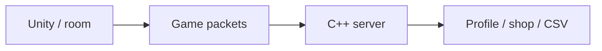

# BNB — Multiplayer Server

[English](README.md) · [Korean](README.ko.md) · [Japanese](README.ja.md)

**C++ · Winsock · C# · Unity** · Team project

[Explore the case](https://ysl-ryudo.github.io/en/work/bnb/) · [Portfolio](https://ysl-ryudo.github.io/en/)

A Windows C++/Winsock server for the BNB team project, covering accounts, rooms, gameplay packets and the shop/reward loop.

## The engineering problem

Rooms, in-game actions, rewards and purchases need a connected client/server flow. Building that loop raised a second question: how should item prices relate to the rewards players earn?

## My implementation

I implemented packet and game integration, room-leader/water-balloon updates, and shop/profile flows. The separate CISC-W study compares fixed and demand-adjusted pricing using simulated player behavior.

### Implementation overview · conceptual flow

### Development videos

- [BNB demo](https://www.youtube.com/watch?v=MI5NtNU9eP8)
- [Slap Squad · OFY Studio](https://www.youtube.com/watch?v=1LMGsY_qY_8)

Recorded project demonstrations; the contribution section below identifies my work within the game.

## My contribution

- Worked on server packet handling and integration with the Unity game.
- Implemented/updated shop packets, profile data handling and item/icon parsing.
- Investigated reward accumulation and item pricing through the related CISC-W 2025 simulation study.

## Contribution evidence

- [Shop packets / 상점 패킷 / ショップパケット](https://github.com/YSL-RyuDo/BnBServer/commit/e41da66566252a105da68d98087198e632c0e9b7)
- [Profile / 프로필 / プロフィール](https://github.com/YSL-RyuDo/BnBServer/commit/37d6db7917815de40823af132aac8c31ed302a87)
- [Icon parsing / 아이콘 파싱 / アイコン解析](https://github.com/YSL-RyuDo/BnBServer/commit/c834f97f91bd8aaf62fe6bc2c7a2c29ea610ed9e)

Commits are evidence of the stated changes, not a percentage-of-authorship score. Third-party assets and teammates' work remain separately credited.

## Open and inspect

Open [TeamOFYServer.sln](TeamOFYServer.sln) in Visual Studio with the Windows C++ workload. Inspect the selected configuration, data paths, dependencies and endpoint settings before starting the matching client. Preserve existing account data.

[BNB](https://github.com/YSL-RyuDo/BNB)

## Development and verification scope

The implementation uses connection threads and CSV-backed data. It is a learning/team-game server, not a benchmarked large-scale service. The research compares pricing policies; deployment of the experimental dynamic policy is not claimed. The paper and the research context are maintained in the BNB client repository.

## How to evaluate the work

Follow the authored client and server commits, then read the paper as a separate experiment. The server uses connection threads and CSV-backed data; some world decisions come from the room leader.
