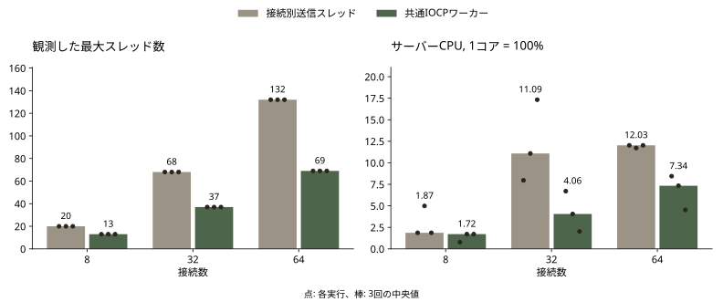
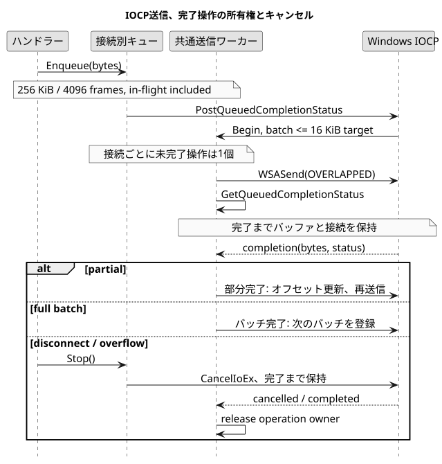

# 遅い受信者の分離を維持しながら送信スレッドを削減

[English](IOCP.md), [한국어](IOCP.ko.md), [日本語](IOCP.ja.md)

2026-10-21

`9e9110727ff5fa8c4cd016f9a55efe4aa93ecc4e` → `8a6245d1a58fdbed77fc62b48eb6984a3af7f017`

最初の上限付きキューは遅い受信者による他ルームの停止を防ぎましたが、接続ごとに送信スレッドを追加しました。この送信側を共通のIOCPワーカー1本へ変更しました。受信スレッドは引き続き接続ごとに存在します。

64接続で、観測した最大スレッド数の中央値は132から69、サーバーCPUは論理コア1個基準で12.03%から7.34%に減少しました。最大RSSの中央値は16.03から14.49 MiBになりました。一方、p95の中央値は14.81から15.35 msに増えました。資源コストの削減であり、すべての応答が速くなったという結果ではありません。

同一Windows機、Release x64、TCPループバック、1ルーム4人、各クライアント20 HzのMOVEです。接続数とバージョンごとに3回、準備2秒、測定10秒、受信待ち2秒を設定し、実行順を交互にしました。表は実行ごとの値の中央値で、p95も各実行のp95の中央値です。CPU 100%は論理コア1個です。参加者のいる待機ルームの配信経路を測定し、Unity描画、WAN、戦闘全体のシミュレーションは含みません。

| 接続数 | スレッド, 前 → 後 | CPU %, 前 → 後 | p95 ms, 前 → 後 | 最大RSS MiB, 前 → 後 |
| --- | --- | --- | --- | --- |
| 8 | 20 → 13 | 1.87 → 1.72 | 12.41 → 15.31 | 11.65 → 11.45 |
| 32 | 68 → 37 | 11.09 → 4.06 | 13.53 → 14.16 | 13.60 → 12.83 |
| 64 | 132 → 69 | 12.03 → 7.34 | 14.81 → 15.35 | 16.03 → 14.49 |



別の読み取り停止試験では、Aルームの1クライアントが受信を止めます。確認用の要求と応答は正常なBルーム内だけで交換します。従来の上限付きキューとIOCP版は、どちらも3回それぞれ300/300応答を届けました。p95の中央値は13.94と11.31 msです。下の0/300 → 300/300の図は以前のblocking send修正の記録で、今回のIOCP比較とは別です。

blocking sendを固定数のワーカープールへ移すだけでは、遅い接続が全ワーカーを占有する可能性があります。overlapped WSASendならソケットの送信を保留したまま完了ワーカーを返せます。測定した8～64接続には送信ワーカー1本を採用しました。本番環境の最大同時接続数や最適なワーカー数を確定した実験ではありません。

接続ごとの256 KiB / 4,096メッセージの上限には送信中のバッチも含めます。接続ごとに未完了操作を1個にして順序を保ち、16 KiBを目安にまとめます。部分完了は残りのバイトから再開します。次のバッチは共有完了キューに戻して他の接続にも処理機会を渡します。キャンセル時も完了通知まで操作がバッファと接続を所有します。キューへの追加成功は相手の受信完了ではありません。



## HITごとのCSV読み取りを削除

GetAttackByIndexはHITごとにCharStat.csvを開いて解析していました。接続受付前に7件の攻撃力を検証して読み込み、その後は変更しないメモリ上のマップを参照します。不明なインデックスは従来どおり0です。不正な開始データでは読み込みが失敗し、ファイル変更の反映には再起動が必要です。起動時スナップショットという方針であり、ホットリロードやDB移行ではありません。

実際のUserManagerコードで10万回の参照を各版5回交互に実行し、全チェックサムが一致しました。ファイルキャッシュが温まった条件で、初期読み込みは除外しています。所要時間の中央値は9044.14 ms → 0.2805 msでした。ファイルの反復オープンと解析を小さなメモリマップ参照と比較したマイクロベンチマークで、ゲームやサーバー全体の同率の高速化を意味しません。

Unity受信部はSplit結果の未完成な末尾も処理し、TCP受信片ごとにUTF-8をデコードしていました。64 KiB上限のバイト蓄積器で改行まで完成したメッセージだけを処理し、その後UTF-8を解釈するように変更しました。分割、結合、韓国語と日本語の途中でのバイト分割、サイズ境界、不正UTF-8を検査しました。正確性の修正でありUnityのFPS改善は測定していません。

送信単体検査7件、実ソケットのフレーミングとルーム検査8件、接続終了検査5件が通過しました。実際のHIT経路でも期待した28応答と他ルーム配信0件を確認しました。起動時キャッシュと独立C#受信パーサーの検査も通過しました。MOVEの18回で欠落、重複、不正形式、他ルーム配信はありませんでした。Unity全体のプレイと長時間負荷は別途検証が必要です。

3回の標本で統計的有意性は主張しません。MOVEの3接続数条件すべてでp95の中央値が増加し、CPUとスレッドのコストは減少しました。受信スレッドは依然として接続数に比例します。CSV永続化とルーム寿命の問題はIOCPで解決されず、監査記録に残しています。

[測定原資料](https://github.com/YSL-RyuDo/BnBServer/tree/main/docs/engineering/measurements/2026-10-21-iocp), [Git diff](https://github.com/YSL-RyuDo/BnBServer/compare/9e9110727ff5fa8c4cd016f9a55efe4aa93ecc4e...8a6245d1a58fdbed77fc62b48eb6984a3af7f017), [コード点検と残る作業](https://github.com/YSL-RyuDo/BnBServer/blob/main/docs/engineering/AUDIT.ja.md)

## 実装と再現方法

Windows, Visual Studio 2022 C++ Desktop, MSVC v143, Release x64, Python 3.10+.

```powershell
git clone https://github.com/YSL-RyuDo/BnBServer.git
cd BnBServer
python -m pip install -r tools/benchmark/requirements.txt
python tools/benchmark/build.py --ref 9e9110727ff5fa8c4cd016f9a55efe4aa93ecc4e --out .bench-work/before --port 39091
python tools/benchmark/build.py --ref 8a6245d1a58fdbed77fc62b48eb6984a3af7f017 --out .bench-work/after --port 39092
python tools/benchmark/test_output.py --out .bench-work/output-unit
python tools/benchmark/regression.py --build .bench-work/after --out .bench-work/regression
python tools/benchmark/lifecycle.py --build .bench-work/after --out .bench-work/lifecycle
python tools/benchmark/hit_regression.py --build .bench-work/after --out .bench-work/hit
python tools/benchmark/backpressure.py --baseline .bench-work/before --candidate .bench-work/after --out .bench-work/pressure --repeats 3
python tools/benchmark/compare.py --baseline .bench-work/before --candidate .bench-work/after --out .bench-work/scale --clients 8 32 64 --repeats 3
# Separate copies: lookup harness replaces main.cpp.
python tools/benchmark/build.py --ref 9e9110727ff5fa8c4cd016f9a55efe4aa93ecc4e --out .bench-work/lookup-before --port 39095
python tools/benchmark/build.py --ref 8a6245d1a58fdbed77fc62b48eb6984a3af7f017 --out .bench-work/lookup-after --port 39096
python tools/benchmark/stats_lookup.py --baseline .bench-work/lookup-before --candidate .bench-work/lookup-after --out .bench-work/lookup
```

[Windows IOCP](https://learn.microsoft.com/en-us/windows/win32/fileio/i-o-completion-ports), [WSASend](https://learn.microsoft.com/en-us/windows/win32/api/winsock2/nf-winsock2-wsasend).
