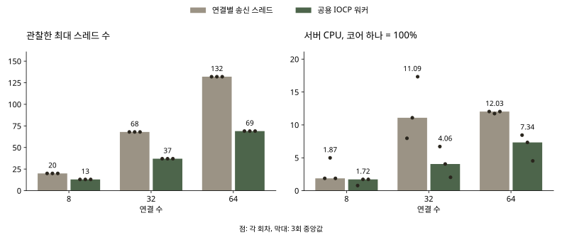
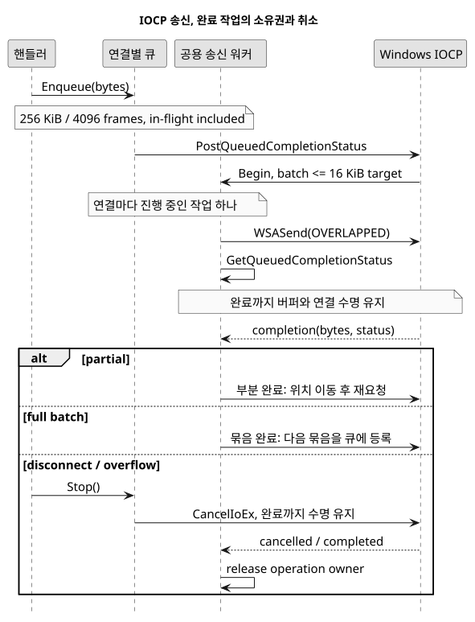

# 느린 수신자 격리를 유지하면서 송신 스레드 비용 줄이기

[English](IOCP.md), [한국어](IOCP.ko.md), [日本語](IOCP.ja.md)

2026-10-21

`9e9110727ff5fa8c4cd016f9a55efe4aa93ecc4e` → `8a6245d1a58fdbed77fc62b48eb6984a3af7f017`

첫 송신 큐 수정은 느린 수신자가 다른 방을 멈추는 문제를 막았지만, 연결마다 송신 스레드를 하나씩 만들었습니다. 이 송신 스레드를 공용 IOCP 워커 하나로 교체했습니다. 수신 스레드는 여전히 연결마다 하나입니다.

64개 연결에서 관찰한 최대 스레드 수의 중앙값은 132개에서 69개, 서버 CPU는 논리 코어 하나 기준 12.03%에서 7.34%로 줄었습니다. 최대 RSS의 중앙값은 16.03 MiB에서 14.49 MiB로 줄었습니다. 반면 p95 중앙값은 14.81 ms에서 15.35 ms로 늘었습니다. 자원 비용은 줄었지만 모든 응답이 빨라졌다는 결과는 아닙니다.

같은 Windows 장비, Release x64, TCP 루프백에서 방마다 4명, 클라이언트마다 초당 MOVE 20회를 보냈습니다. 연결 수와 버전별로 3회 반복하고 준비 2초, 측정 10초, 수신 대기 2초를 적용했습니다. 버전 실행 순서는 번갈아 배치했습니다. 아래 값은 회차별 값의 중앙값이며 p95도 회차별 p95의 중앙값입니다. CPU 100%는 논리 코어 하나입니다. 참가자가 있는 대기실의 전달 경로를 측정했으며 Unity 렌더링, 인터넷 통신, 전체 전투 시뮬레이션은 포함하지 않습니다.

| 연결 수 | 스레드, 이전 → 이후 | CPU %, 이전 → 이후 | p95 ms, 이전 → 이후 | 최대 RSS MiB, 이전 → 이후 |
| --- | --- | --- | --- | --- |
| 8 | 20 → 13 | 1.87 → 1.72 | 12.41 → 15.31 | 11.65 → 11.45 |
| 32 | 68 → 37 | 11.09 → 4.06 | 13.53 → 14.16 | 13.60 → 12.83 |
| 64 | 132 → 69 | 12.03 → 7.34 | 14.81 → 15.35 | 16.03 → 14.49 |



별도 읽기 중단 실험에서는 A방의 한 클라이언트가 수신을 멈춥니다. 확인용 요청과 응답은 정상 B방 안에서만 오갑니다. 기존 제한 큐와 IOCP 버전 모두 3회 각각 B방 응답 300/300건을 전달했습니다. p95 중앙값은 13.94 ms와 11.31 ms였습니다. 아래의 0/300 → 300/300 그래프는 앞선 blocking send 수정의 기록이며 이번 IOCP 비교 결과와 구분됩니다.

blocking send를 고정 크기 스레드 풀에 넣으면 스레드 수는 제한할 수 있지만, 느린 수신자가 모든 워커를 점유할 수 있습니다. overlapped WSASend는 느린 소켓의 송신을 대기 상태로 두면서 완료 워커를 반환합니다. 이번에 측정한 8~64개 연결 범위에는 송신 워커 하나를 적용했습니다. 이 실험으로 운영 환경의 최대 동접이나 최적 워커 수를 확정하지는 않았습니다.

연결마다 전송 중인 묶음을 포함해 256 KiB와 4,096개 메시지 한도를 유지합니다. 연결별로 진행 중인 송신을 하나만 두어 순서를 보존하고, 16 KiB를 기준으로 메시지를 묶습니다. 부분 완료는 남은 바이트부터 이어 보냅니다. 다음 묶음은 공용 완료 큐에 다시 넣어 다른 연결에도 처리 기회를 줍니다. 취소된 경우에도 완료 통지를 받을 때까지 작업 객체가 버퍼와 연결의 수명을 유지합니다. 큐 삽입 성공은 상대의 수신 완료를 의미하지 않습니다.



## 피격 처리마다 반복하던 CSV 읽기 제거

GetAttackByIndex는 HIT마다 CharStat.csv를 열고 파싱했습니다. 서버가 연결을 받기 전에 공격력 7개를 검증해 읽고, 이후에는 변경하지 않는 메모리 맵을 조회하도록 바꿨습니다. 없는 인덱스는 기존처럼 0을 반환합니다. 시작 데이터가 잘못되면 로딩에 실패하며, 파일 변경은 서버를 다시 시작해야 반영됩니다. 시작 시점의 설정을 유지하는 정책이며 핫 리로드나 DB 전환은 아닙니다.

실제 UserManager 코드에서 조회 10만 회를 버전별 5회씩 번갈아 실행했고 결과 체크섬은 모두 같았습니다. 파일 캐시가 준비된 조건이며 초기 로딩은 제외했습니다. 소요 시간 중앙값은 9044.14 ms → 0.2805 ms였습니다. 반복적인 파일 열기와 파싱을 작은 메모리 맵 조회와 비교한 결과입니다. 게임 전체나 서버 처리량이 같은 비율로 빨라졌다고 해석할 수 없습니다.

Unity 수신부는 Split 결과의 마지막 미완성 조각까지 처리하고, TCP 수신 조각마다 UTF-8을 따로 디코딩하고 있었습니다. 64 KiB 상한의 바이트 누적 버퍼를 넣어 개행으로 완성된 메시지만 처리하고 그 뒤에 UTF-8을 해석하도록 바꿨습니다. 분할 수신, 여러 메시지의 합쳐진 수신, 한글과 일본어 바이트 분할, 크기 경계와 잘못된 UTF-8을 검사했습니다. 정확성 수정이며 Unity FPS 개선 수치를 측정한 것은 아닙니다.

송신 단위 검사 7개, 실제 소켓의 수신 경계와 방 구분 검사 8개, 연결 정리 검사 5개를 통과했습니다. 실제 HIT 경로에서도 기대한 피해 응답 28건과 다른 방 전달 0건을 확인했습니다. 시작 공격력 캐시와 독립 C# 수신 파서 검사도 통과했습니다. MOVE 18회 측정에서 누락, 중복, 형식 오류, 다른 방 전달은 없었습니다. Unity 전체 플레이와 장시간 부하는 별도의 검증이 필요합니다.

3회 표본으로 통계적 유의성을 주장하지 않습니다. MOVE 측정에서는 세 연결 수 조건 모두 p95 중앙값이 늘었고 CPU와 스레드 비용은 줄었습니다. 수신 스레드는 여전히 연결 수에 비례합니다. CSV 저장과 방 객체 수명 문제는 IOCP 변경으로 해결되지 않으며 아래 점검 기록에 남겼습니다.

[측정 원자료](https://github.com/YSL-RyuDo/BnBServer/tree/main/docs/engineering/measurements/2026-10-21-iocp), [Git diff](https://github.com/YSL-RyuDo/BnBServer/compare/9e9110727ff5fa8c4cd016f9a55efe4aa93ecc4e...8a6245d1a58fdbed77fc62b48eb6984a3af7f017), [코드 점검과 남은 작업](https://github.com/YSL-RyuDo/BnBServer/blob/main/docs/engineering/AUDIT.ko.md)

## 구현과 재현 방법

Windows, Visual Studio 2022 C++ Desktop, MSVC v143, Release x64, Python 3.10+.

```powershell
git clone https://github.com/YSL-RyuDo/BnBServer.git
cd BnBServer
python -m pip install -r tools/benchmark/requirements.txt
python tools/benchmark/build.py --ref 9e9110727ff5fa8c4cd016f9a55efe4aa93ecc4e --out .bench-work/before --port 39091
python tools/benchmark/build.py --ref 8a6245d1a58fdbed77fc62b48eb6984a3af7f017 --out .bench-work/after --port 39092
python tools/benchmark/test_output.py --out .bench-work/output-unit
python tools/benchmark/regression.py --build .bench-work/after --out .bench-work/regression
python tools/benchmark/lifecycle.py --build .bench-work/after --out .bench-work/lifecycle
python tools/benchmark/hit_regression.py --build .bench-work/after --out .bench-work/hit
python tools/benchmark/backpressure.py --baseline .bench-work/before --candidate .bench-work/after --out .bench-work/pressure --repeats 3
python tools/benchmark/compare.py --baseline .bench-work/before --candidate .bench-work/after --out .bench-work/scale --clients 8 32 64 --repeats 3
# Separate copies: lookup harness replaces main.cpp.
python tools/benchmark/build.py --ref 9e9110727ff5fa8c4cd016f9a55efe4aa93ecc4e --out .bench-work/lookup-before --port 39095
python tools/benchmark/build.py --ref 8a6245d1a58fdbed77fc62b48eb6984a3af7f017 --out .bench-work/lookup-after --port 39096
python tools/benchmark/stats_lookup.py --baseline .bench-work/lookup-before --candidate .bench-work/lookup-after --out .bench-work/lookup
```

[Windows IOCP](https://learn.microsoft.com/en-us/windows/win32/fileio/i-o-completion-ports), [WSASend](https://learn.microsoft.com/en-us/windows/win32/api/winsock2/nf-winsock2-wsasend).
