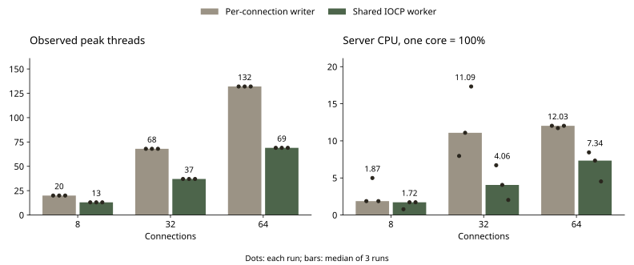
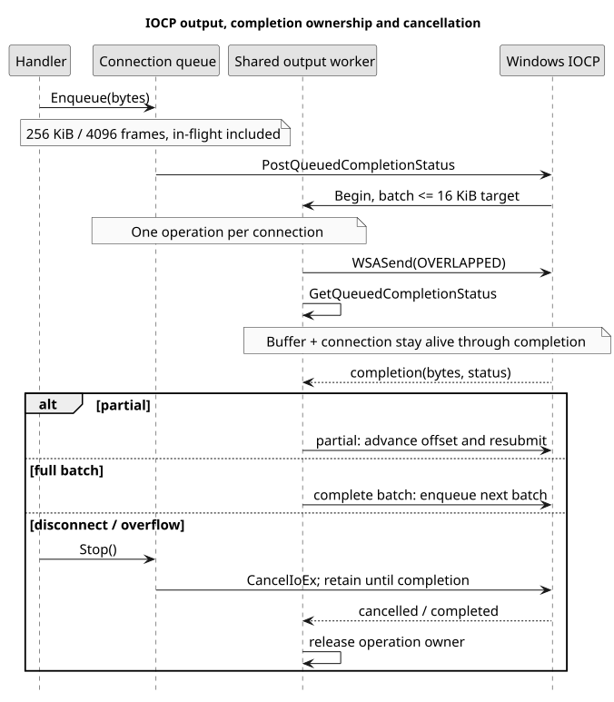

# Reducing output-thread cost without losing slow-reader isolation

[English](IOCP.md), [한국어](IOCP.ko.md), [日本語](IOCP.ja.md)

2026-10-21

`9e9110727ff5fa8c4cd016f9a55efe4aa93ecc4e` → `8a6245d1a58fdbed77fc62b48eb6984a3af7f017`

The first bounded-queue fix prevented a stalled reader from blocking other rooms, but created a writer thread for every connection. I replaced those writers with one shared IOCP output worker. Receive threads remain per connection.

At 64 connections, the median observed peak thread count fell from 132 to 69, and server CPU from 12.03% to 7.34% of one logical core. Median peak RSS fell from 16.03 to 14.49 MiB. The p95 median increased from 14.81 to 15.35 ms. This is a reduction in resource cost, not a claim that every response became faster.

Same Windows machine, Release x64, TCP loopback, 4 clients per room, MOVE at 20 Hz per client. Each variant has three runs per connection count, with 2 s warmup, 10 s measurement and 2 s drain. Variant order alternates. Values below are medians of per-run values; p95 is the median of run p95s. CPU 100% means one logical core. These populated waiting-room tests exclude Unity rendering, WAN traffic and full battle simulation.

| Connections | Threads, before → after | CPU %, before → after | p95 ms, before → after | Peak RSS MiB, before → after |
| --- | --- | --- | --- | --- |
| 8 | 20 → 13 | 1.87 → 1.72 | 12.41 → 15.31 | 11.65 → 11.45 |
| 32 | 68 → 37 | 11.09 → 4.06 | 13.53 → 14.16 | 13.60 → 12.83 |
| 64 | 132 → 69 | 12.03 → 7.34 | 14.81 → 15.35 | 16.03 → 14.49 |



In the separate stopped-reader test, one client in room A stops receiving. All probes stay inside healthy room B. Both the old bounded queue and the IOCP version delivered 300/300 B-room responses in each of three runs. Their p95 medians were 13.94 and 11.31 ms. The historical 0/300 → 300/300 chart below belongs to the earlier blocking-send fix, not this IOCP comparison.

A fixed pool of blocking send workers would limit thread count, but enough stalled peers could occupy every worker. Overlapped WSASend allows a slow socket to remain pending without tying up the completion worker. I selected one output worker for the measured range of 8–64 connections; these tests do not establish a production capacity limit or the optimal worker count.

Each connection keeps its own 256 KiB / 4,096-frame limit, including the in-flight batch. Only one operation is outstanding per connection, preserving order. A batch targets 16 KiB. Completions advance partial writes; the next batch returns to the shared completion queue to give other sockets a turn. The operation retains both its byte buffer and the connection until completion, including cancellation. Enqueue success means accepted for sending, not received by the peer.



## Removing per-hit CSV reads

GetAttackByIndex reopened and parsed CharStat.csv for every HIT. The server now validates and loads the seven-entry attack table before accepting connections, then reads an immutable in-memory map. Unknown indices still return zero. Invalid startup data fails loading; changes to the file require a restart. This is a deliberate startup-snapshot policy, not hot reload or a database migration.

Actual UserManager code, 100,000 lookups, five alternating runs per variant, matching checksums. Warm filesystem cache; initial loading is excluded. Median elapsed time: 9044.14 ms → 0.2805 ms. This isolates file-open/parsing work versus a tiny hot map. It must not be presented as an equivalent speedup in the game or server throughput.

The Unity receiver also dispatched the incomplete final fragment returned by Split, and decoded UTF-8 separately for each TCP read. I added a 64 KiB bounded byte accumulator that dispatches only complete newline-delimited messages and decodes UTF-8 after framing. Tests cover fragmented/coalesced messages, split Korean/Japanese characters, exact size limits and malformed UTF-8. This is a correctness fix; no Unity FPS improvement was measured.

Validation: 7 output unit checks, 8 socket framing/room checks, 5 connection-lifecycle checks, and a real-socket HIT check delivering 28 expected damage responses without cross-room delivery. Startup-cache and standalone C# framing tests also passed. The 18 MOVE runs had no missing, duplicated, malformed or cross-room messages. End-to-end Unity gameplay and long-duration soak tests remain separate work.

The three-run sample is too small to claim statistical significance. p95 increased in all three MOVE connection-count medians, while CPU and thread cost fell. Receive threads still scale with connections. The CSV persistence and room lifetime risks listed in the audit are not solved by IOCP.

[Raw measurements](https://github.com/YSL-RyuDo/BnBServer/tree/main/docs/engineering/measurements/2026-10-21-iocp), [Git diff](https://github.com/YSL-RyuDo/BnBServer/compare/9e9110727ff5fa8c4cd016f9a55efe4aa93ecc4e...8a6245d1a58fdbed77fc62b48eb6984a3af7f017), [Code audit and remaining work](https://github.com/YSL-RyuDo/BnBServer/blob/main/docs/engineering/AUDIT.md)

## Implementation and reproduction

Windows, Visual Studio 2022 C++ Desktop, MSVC v143, Release x64, Python 3.10+.

```powershell
git clone https://github.com/YSL-RyuDo/BnBServer.git
cd BnBServer
python -m pip install -r tools/benchmark/requirements.txt
python tools/benchmark/build.py --ref 9e9110727ff5fa8c4cd016f9a55efe4aa93ecc4e --out .bench-work/before --port 39091
python tools/benchmark/build.py --ref 8a6245d1a58fdbed77fc62b48eb6984a3af7f017 --out .bench-work/after --port 39092
python tools/benchmark/test_output.py --out .bench-work/output-unit
python tools/benchmark/regression.py --build .bench-work/after --out .bench-work/regression
python tools/benchmark/lifecycle.py --build .bench-work/after --out .bench-work/lifecycle
python tools/benchmark/hit_regression.py --build .bench-work/after --out .bench-work/hit
python tools/benchmark/backpressure.py --baseline .bench-work/before --candidate .bench-work/after --out .bench-work/pressure --repeats 3
python tools/benchmark/compare.py --baseline .bench-work/before --candidate .bench-work/after --out .bench-work/scale --clients 8 32 64 --repeats 3
# Separate copies: lookup harness replaces main.cpp.
python tools/benchmark/build.py --ref 9e9110727ff5fa8c4cd016f9a55efe4aa93ecc4e --out .bench-work/lookup-before --port 39095
python tools/benchmark/build.py --ref 8a6245d1a58fdbed77fc62b48eb6984a3af7f017 --out .bench-work/lookup-after --port 39096
python tools/benchmark/stats_lookup.py --baseline .bench-work/lookup-before --candidate .bench-work/lookup-after --out .bench-work/lookup
```

[Windows IOCP](https://learn.microsoft.com/en-us/windows/win32/fileio/i-o-completion-ports), [WSASend](https://learn.microsoft.com/en-us/windows/win32/api/winsock2/nf-winsock2-wsasend).
