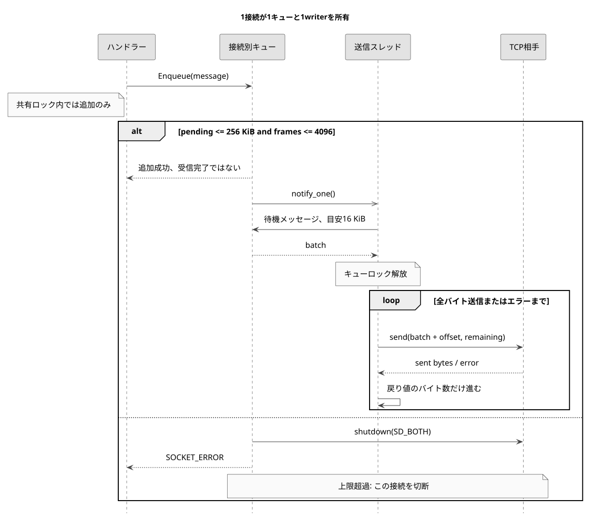
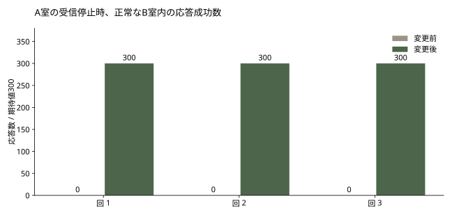

# 遅い受信者が別のルームを止めないようにする

以前の段階の記録です。当時は接続ごとにblocking送信スレッドを設けました。現在の実装は上記のIOCP版で、旧測定値は変更履歴として保持します。 [IOCP](IOCP.ja.md)

[English](OUTPUT_QUEUE.md), [한국어](OUTPUT_QUEUE.ko.md), [日本語](OUTPUT_QUEUE.ja.md)

2026-10-21

`737a92c397adb4320cf439d99d148362ce1ca090` → `9e9110727ff5fa8c4cd016f9a55efe4aa93ecc4e`

MOVEの配信範囲を修正した後にも問題が残りました。読み取りを止めたクライアントへのsendがブロックするとルームのロックが解放されず、別のルームも進行できません。実際のソケットで再現し、接続ごとに上限付きキューを設けてソケットへの書き込みを分離しました。

共有ロックを解放して送信する方法、接続ごとの送信スレッド、IOCPを比較しました。ロックを解放するだけでは、同じソケットへの並行書き込みや送信待ちデータの上限を解決できません。既存のテキストプロトコルとハンドラーを維持しながら待機を分離するため、接続ごとの単一writerと上限付きキューを選びました。IOCPは接続ごとのスレッド費用を減らせますが、完了通知とバッファ寿命の設計変更が必要です。



ハンドラーは完成したメッセージをキューに入れ、Winsock sendはSocketOutput::Runだけが呼びます。待機中のメッセージを16 KiBを目安にまとめ、部分送信では戻り値のバイト数だけ進めて残りを送ります。16 KiBを超える単一メッセージはそのまま扱います。キュー内の順序は維持し、並行する生成元の順序はゲーム全体の時刻ではなくキューのロック取得順です。

接続ごとの待機payloadは256 KiB、4,096メッセージまでとし、送信中のバッチも含めます。どちらかを超えた接続は切断します。空きを待つと共有ロック内で再び止まり、任意のメッセージを捨てるとチャット、購入、試合イベントの意味を壊すためです。上限は実験用であり、運用環境に合わせた容量ではありません。dequeの管理領域、バッチの一時コピー、ソケットバッファ、スレッドスタックは別のメモリです。

## コミットした実装の部分送信ループ

```cpp
size_t offset = 0;
while (offset < batch.size() && !stopping_) {
    const int sent = sender_(socket_, batch.data() + offset, static_cast<int>(batch.size() - offset), 0);
    {
        std::lock_guard<std::mutex> lock(mutex_);
        ++stats_.sendCalls;
        if (sent > 0) stats_.sentBytes += sent;
    }
    if (sent <= 0) { Stop(2); break; }
    offset += sent;
}
```

比較元は既にルーム別MOVE配信を実装した版です。仮想クライアント8人が4人ずつ2つの待機ルームに入ります。ルーム0の1人は受信バッファに1,024バイトを要求して読み取りを停止し、同室の別クライアントが2,048文字のチャットを20msごとに10件送ります。1秒後、別室からMOVEを20Hzで100件送り、観測者への300件の配信を確認します。最後に1秒間受信を待ちます。通常条件と読み取り停止条件を各版3回、交互の順序で同じWindows PCのloopback上で実行しました。

読み取り停止条件では、従来版の別室への応答は3回とも観測時間内に0/300件でした。修正版は毎回300件すべてを配信し、重複はありませんでした。遅い接続の影響を分離した結果であり、インターネット遅延や最大同時接続数の測定ではありません。従来版は応答がないためp95を定義できず、0msや速度向上率として扱いません。

| 条件 / 指標 | 変更前、ルーム別blocking send | 変更後、上限付き送信キュー |
| --- | --- | --- |
| 読み取り停止、各回の別室への配信 | 0 / 300 | 300 / 300 |
| 読み取り停止、各回p95の中央値 | 定義不可、応答なし | 13.82 ms |
| 通常条件、各回の別室への配信 | 300 / 300 | 300 / 300 |
| 通常条件、各回p95の中央値 | 14.00 ms | 13.62 ms |
| 観測した最大スレッド数、8接続 | 12 | 20 |

各条件と各版を3回実行しました。遅延は送信直前から観測者の完全な行の受信までで、サーバー内部の処理時間ではありません。各回のCPU、RSS、応答記録は生データにあります。



通常条件の遅延は明確には改善しませんでした。8接続で観測した最大サーバースレッド数は12から20へ増えました。停止した従来版のCPU使用率が低いのは処理が進んでいないためです。接続ごとの受信スレッドを残し、送信スレッドを1つずつ追加した費用も示します。

QUITは受信ループに後処理を任せ、SocketOutputがshutdown、writerのjoin、最後のclosesocketを所有します。ログアウトではIDを消す前にルームから削除します。ロビー通知は接続ロック内で送信先の所有権とIDをコピーし、その後メッセージを作ってキューに入れます。ルーム削除通知の2経路では、接続ロック中にルームのロックを取得する呼び出しを分離しました。

決定的な6テストで強制的な部分送信、4つの生成スレッド、バイトとメッセージ数の上限、バッチ化、送信失敗を確認しました。制御したバッチ化テストでは2バイトのメッセージ1,000件を注入した送信関数の2回の呼び出しで渡しました。1件1呼び出しのモデルなら1,000回です。これは関数呼び出し数であり、実際のパケット数、スループット、FPSではありません。実ソケット検査は従来の8項目に不正な購入数値、ログアウトと再ログイン、QUIT/EOFの20回反復、4人同時切断を加えた13項目に合格しました。接続反復後のスレッド数は開始時と同じでした。

切断時は待機メッセージを破棄するため、正常な配信完了を保証する終了処理ではありません。キューへの追加成功も相手の受信完了を意味しません。サーバー全体の終了、既存セッション検索とルームポインタ寿命の一貫した同期、購入の永続化、サーバーでの命中検証は今後の課題です。下の配信範囲の測定は前段階の結果を保持し、2つの変更を別々に評価できるようにしています。

[12回の生データとビルド根拠](https://github.com/YSL-RyuDo/BnBServer/tree/main/docs/engineering/measurements/2026-10-21-output-queue), [Git diff](https://github.com/YSL-RyuDo/BnBServer/compare/737a92c397adb4320cf439d99d148362ce1ca090...9e9110727ff5fa8c4cd016f9a55efe4aa93ecc4e), [SocketOutput.cpp](https://github.com/YSL-RyuDo/BnBServer/blob/9e9110727ff5fa8c4cd016f9a55efe4aa93ecc4e/TeamOFYServer/SocketOutput.cpp)

## 送信キューの設計と再現方法

```powershell
git clone https://github.com/YSL-RyuDo/BnBServer.git
cd BnBServer
python -m pip install -r tools/benchmark/requirements.txt
python tools/benchmark/build.py --ref 737a92c397adb4320cf439d99d148362ce1ca090 --out .bench-work/before --port 39091
python tools/benchmark/build.py --ref 9e9110727ff5fa8c4cd016f9a55efe4aa93ecc4e --out .bench-work/after --port 39092
python tools/benchmark/regression.py --build .bench-work/after --out .bench-work/regression
python tools/benchmark/lifecycle.py --build .bench-work/after --out .bench-work/lifecycle
python tools/benchmark/test_output.py --out .bench-work/output-unit
python tools/benchmark/backpressure.py --baseline .bench-work/before --candidate .bench-work/after --out .bench-work/output-comparison --repeats 3
python -m pip install matplotlib==3.10.5
python tools/benchmark/plot_output.py --results .bench-work/output-comparison/results.json --out .bench-work/output-charts
```

Windows, Visual Studio 2022 Desktop development with C++, MSVC v143, Release x64, Python 3.10+.

[Winsock send](https://learn.microsoft.com/en-us/windows/win32/api/winsock2/nf-winsock2-send), [Winsock shutdown](https://learn.microsoft.com/en-us/windows/win32/api/winsock2/nf-winsock2-shutdown).
