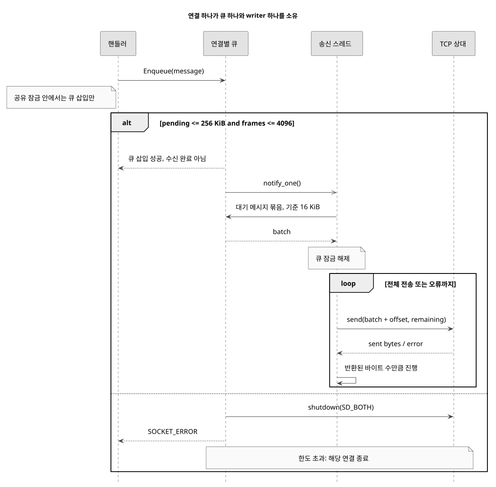
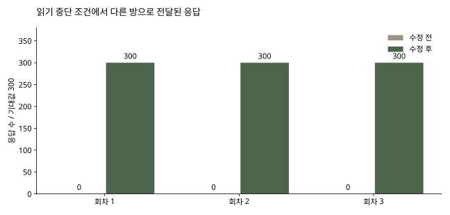

# 느린 수신자 한 명이 다른 방까지 멈추지 않도록

이전 단계의 기록입니다. 당시에는 연결마다 blocking 송신 스레드를 두었습니다. 현재 구현은 위의 IOCP 방식이며 이전 측정값은 변경 이력으로 보존합니다. [IOCP](IOCP.ko.md)

[English](OUTPUT_QUEUE.md), [한국어](OUTPUT_QUEUE.ko.md), [日本語](OUTPUT_QUEUE.ja.md)

2026-10-21

`737a92c397adb4320cf439d99d148362ce1ca090` → `9e9110727ff5fa8c4cd016f9a55efe4aa93ecc4e`

MOVE 전달 범위를 고친 뒤에도 문제가 남았습니다. 읽기를 멈춘 클라이언트 때문에 send가 막히면 방 잠금이 풀리지 않아 다른 방의 요청까지 진행하지 못했습니다. 실제 소켓으로 재현한 뒤, 연결마다 크기를 제한한 송신 큐를 두고 소켓 쓰기를 분리했습니다.

공유 잠금을 풀고 송신하는 방법, 연결별 송신 스레드, IOCP를 비교했습니다. 잠금만 풀면 같은 소켓에 여러 스레드가 동시에 쓰는 문제와 송신 대기량 문제가 남습니다. 기존 텍스트 프로토콜과 핸들러를 유지하면서 소켓 대기를 분리하기 위해 연결별 단일 writer와 제한된 큐를 선택했습니다. IOCP는 연결당 스레드 비용을 줄일 수 있지만 완료 통지와 버퍼 수명 관리부터 별도로 바꿔야 합니다.



핸들러는 완성된 메시지를 큐에 넣고, 실제 Winsock send는 SocketOutput::Run만 호출합니다. 대기 중인 메시지는 16 KiB를 기준으로 묶습니다. 일부만 전송되면 반환된 바이트 수만큼 위치를 옮겨 나머지를 이어 보냅니다. 단일 메시지가 16 KiB보다 크면 그 메시지는 그대로 처리합니다. 큐의 순서는 유지하며, 동시 생산자 사이의 순서는 게임 전체 시간이 아닌 큐 잠금 획득 순서입니다.

연결 하나의 대기 payload를 256 KiB와 4,096개 메시지로 제한했습니다. 전송 중인 묶음도 포함합니다. 한도를 넘으면 해당 연결을 종료합니다. 빈자리가 날 때까지 기다리면 공유 잠금 안에서 다시 막히고, 메시지를 임의로 버리면 채팅과 구매, 경기 이벤트의 의미가 깨질 수 있기 때문입니다. 이 한도는 실험값이며 운영 환경에서 조정한 용량은 아닙니다. deque 관리 비용, 임시 묶음 복사, 소켓 버퍼와 스레드 스택은 별도 메모리입니다.

## 커밋된 구현의 부분 송신 반복문

```cpp
size_t offset = 0;
while (offset < batch.size() && !stopping_) {
    const int sent = sender_(socket_, batch.data() + offset, static_cast<int>(batch.size() - offset), 0);
    {
        std::lock_guard<std::mutex> lock(mutex_);
        ++stats_.sendCalls;
        if (sent > 0) stats_.sentBytes += sent;
    }
    if (sent <= 0) { Stop(2); break; }
    offset += sent;
}
```

비교 기준은 이미 방별 MOVE 전달을 적용한 버전입니다. 가상 클라이언트 8명이 4인 대기실 두 개에 접속합니다. 0번 방의 한 수신자는 수신 버퍼를 1,024바이트로 요청하고 읽기를 멈춥니다. 같은 방의 다른 클라이언트는 2,048자 채팅을 20ms마다 10개씩 보냅니다. 1초 뒤 다른 방에서 MOVE 100건을 20Hz로 보내 관찰자 응답 300건을 기다리고, 마지막 1초를 추가 수신 시간으로 둡니다. 정상 조건과 읽기 중단 조건을 버전별 3회씩 번갈아 실행했습니다. 서버와 생성기는 같은 Windows PC의 loopback에서 실행했습니다.

읽기 중단 조건에서 기존 코드는 3회 모두 다른 방의 응답 300건 중 0건을 관찰 시간 내에 전달했습니다. 수정 후에는 매번 300건 전부 전달했고 중복은 없었습니다. 느린 연결의 영향을 분리한 결과입니다. 인터넷 지연이나 최대 동접 수를 측정한 결과는 아닙니다. 기존 코드에서는 받은 응답이 없어 p95를 계산할 수 없으며, 이를 0ms로 적거나 배속 향상률을 계산하지 않았습니다.

| 조건 / 지표 | 이전, 방별 blocking send | 이후, 제한된 송신 큐 |
| --- | --- | --- |
| 읽기 중단, 회차별 정상 B방 내부 응답 | 0 / 300 | 300 / 300 |
| 읽기 중단, 회차별 p95의 중앙값 | 계산 불가, 수신 응답 없음 | 13.82 ms |
| 정상 조건, 회차별 정상 B방 내부 응답 | 300 / 300 | 300 / 300 |
| 정상 조건, 회차별 p95의 중앙값 | 14.00 ms | 13.62 ms |
| 관찰한 최대 스레드, 연결 8개 | 12 | 20 |

조건과 버전마다 3회 반복했습니다. 지연은 송신 직전부터 관찰자가 완성된 줄을 받을 때까지이며 서버 내부 처리 시간과 다릅니다. 회차별 CPU, RSS, 응답 기록은 원자료에 있습니다.



정상 조건의 지연은 뚜렷하게 개선되지 않았습니다. 8개 연결에서 관찰한 최대 서버 스레드는 12개에서 20개로 늘었습니다. 기존 코드가 멈췄을 때 CPU 사용률이 낮은 것은 요청 처리를 하지 못했기 때문입니다. 기존 연결별 수신 스레드를 유지하고 송신 스레드를 하나씩 추가한 비용을 함께 비교했습니다.

QUIT는 수신 루프에 정리를 맡기고, SocketOutput이 shutdown, writer 종료 대기, 마지막 closesocket을 소유하도록 바꿨습니다. 로그아웃은 사용자 ID를 지우기 전에 방에서 제거합니다. 로비 알림은 접속 목록 잠금 안에서 수신자와 ID를 복사한 뒤 메시지를 만들고 큐에 넣습니다. 방 삭제 알림의 두 경로에서는 접속 목록 잠금을 잡은 채 방 잠금을 요구하던 호출을 분리했습니다.

결정적 단위 검사 6개로 강제 부분 송신, 생산자 스레드 4개, 바이트와 메시지 수 제한, 묶음 전송, 송신 실패를 확인했습니다. 묶음 전송 검사에서는 2바이트 메시지 1,000개가 주입한 송신 함수 2회 호출로 전달됐습니다. 메시지당 한 번 호출하는 모델이라면 1,000회입니다. 이는 송신 함수 호출 수이며 실제 패킷 수나 처리량, FPS 측정이 아닙니다. 실제 소켓 회귀 검사는 기존 8개에 잘못된 구매 숫자, 로그아웃과 재로그인, QUIT/EOF 20회 반복, 4명 동시 접속 종료를 더한 13개를 통과했습니다. 반복 접속 후 스레드 수는 시작 시점으로 돌아왔습니다.

연결 종료 시 대기 메시지를 폐기하므로 정상적인 전송 완료를 보장하는 종료 방식은 아닙니다. 큐 삽입 성공도 상대의 수신 완료를 뜻하지 않습니다. 서버 전체 종료, 기존 세션 조회와 방 포인터 수명의 일관된 동기화, 구매 저장, 서버의 명중 검증은 추가 작업입니다. 아래 방별 전달 측정은 앞선 수정 버전의 결과를 그대로 남겨 두 변경을 각각 확인할 수 있게 했습니다.

[12회 원자료와 빌드 근거](https://github.com/YSL-RyuDo/BnBServer/tree/main/docs/engineering/measurements/2026-10-21-output-queue), [Git diff](https://github.com/YSL-RyuDo/BnBServer/compare/737a92c397adb4320cf439d99d148362ce1ca090...9e9110727ff5fa8c4cd016f9a55efe4aa93ecc4e), [SocketOutput.cpp](https://github.com/YSL-RyuDo/BnBServer/blob/9e9110727ff5fa8c4cd016f9a55efe4aa93ecc4e/TeamOFYServer/SocketOutput.cpp)

## 송신 큐 설계와 재현 방법

```powershell
git clone https://github.com/YSL-RyuDo/BnBServer.git
cd BnBServer
python -m pip install -r tools/benchmark/requirements.txt
python tools/benchmark/build.py --ref 737a92c397adb4320cf439d99d148362ce1ca090 --out .bench-work/before --port 39091
python tools/benchmark/build.py --ref 9e9110727ff5fa8c4cd016f9a55efe4aa93ecc4e --out .bench-work/after --port 39092
python tools/benchmark/regression.py --build .bench-work/after --out .bench-work/regression
python tools/benchmark/lifecycle.py --build .bench-work/after --out .bench-work/lifecycle
python tools/benchmark/test_output.py --out .bench-work/output-unit
python tools/benchmark/backpressure.py --baseline .bench-work/before --candidate .bench-work/after --out .bench-work/output-comparison --repeats 3
python -m pip install matplotlib==3.10.5
python tools/benchmark/plot_output.py --results .bench-work/output-comparison/results.json --out .bench-work/output-charts
```

Windows, Visual Studio 2022 Desktop development with C++, MSVC v143, Release x64, Python 3.10+.

[Winsock send](https://learn.microsoft.com/en-us/windows/win32/api/winsock2/nf-winsock2-send), [Winsock shutdown](https://learn.microsoft.com/en-us/windows/win32/api/winsock2/nf-winsock2-shutdown).
