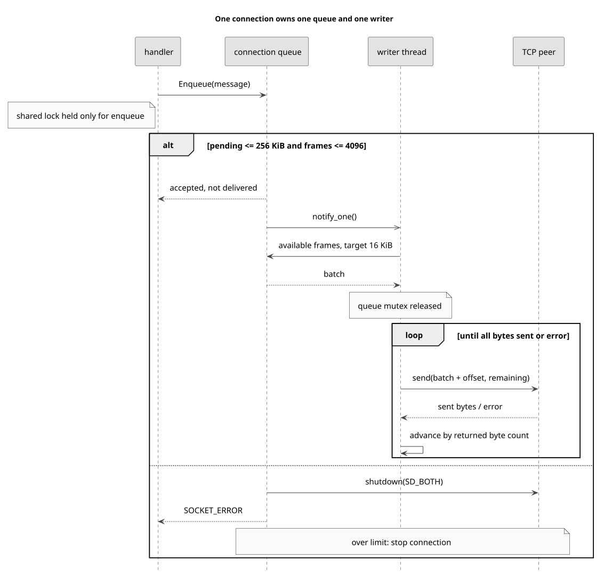
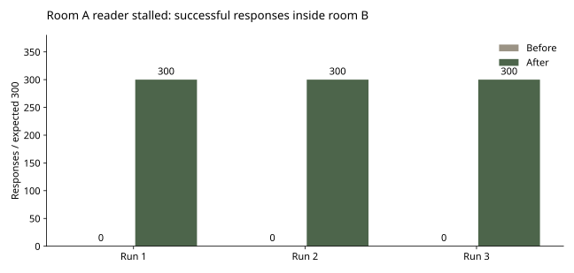

# A slow reader must not stop another room

Earlier stage, one blocking writer per connection. The current implementation is the IOCP version above. These original measurements are retained as history. [IOCP](IOCP.md)

[English](OUTPUT_QUEUE.md), [한국어](OUTPUT_QUEUE.ko.md), [日本語](OUTPUT_QUEUE.ja.md)

2026-10-21

`737a92c397adb4320cf439d99d148362ce1ca090` → `9e9110727ff5fa8c4cd016f9a55efe4aa93ecc4e`

After correcting MOVE fan-out, I reproduced another failure: a blocked send held the room lock, so one client that stopped reading prevented a different room from making progress. I moved socket writes to a bounded queue owned by each connection.

I considered sending after releasing the shared lock, a dedicated writer per connection, and IOCP. Releasing the lock alone would not serialize concurrent writes to the same socket or bound pending data. I chose one writer with a bounded queue to preserve the existing text protocol and handlers while isolating socket waits. IOCP would reduce the per-connection thread cost, but requires a separate redesign of completion handling and buffer lifetime.



Handlers enqueue complete messages. Only SocketOutput::Run calls Winsock send. The writer combines available messages into batches targeted at 16 KiB and resumes from the returned byte count after a partial send. A single message larger than 16 KiB remains intact. FIFO order is preserved within the queue; concurrent producers are ordered by enqueue acquisition, not by a global game clock.

Pending payload is limited to 256 KiB and 4,096 frames per connection, including the batch currently being sent. Exceeding either limit disconnects that client. Waiting for space would reintroduce blocking under shared locks; dropping arbitrary messages would corrupt the meaning of chat, purchases and match events. These are experiment limits, not production-tuned capacity estimates. Deque overhead, a temporary batch copy, socket buffers and thread stacks are additional memory.

## The partial-send loop, from the committed implementation

```cpp
size_t offset = 0;
while (offset < batch.size() && !stopping_) {
    const int sent = sender_(socket_, batch.data() + offset, static_cast<int>(batch.size() - offset), 0);
    {
        std::lock_guard<std::mutex> lock(mutex_);
        ++stats_.sendCalls;
        if (sent > 0) stats_.sentBytes += sent;
    }
    if (sent <= 0) { Stop(2); break; }
    offset += sent;
}
```

The comparison uses the room-scoped revision as its baseline. Eight synthetic clients join two four-player waiting rooms. One reader in room 0 pauses reads with a requested 1,024-byte receive buffer. A peer offers 2,048-character chat payloads in bursts of 10 every 20 ms. After one second, room 1 sends 100 MOVE requests at 20 Hz, expecting 300 observer deliveries, followed by one second of drain. Quiet and stopped-reader conditions each run three times per revision, alternating order, on one Windows host over loopback.

Every stopped-reader baseline run delivered 0 of 300 healthy-room responses before the observation window ended. Every revised run delivered all 300 with no duplicates. This is evidence of isolating a stalled connection, not a claim about Internet latency or maximum player capacity. With no delivered baseline responses, its p95 is undefined; it is not zero and cannot support a speedup ratio.

| Condition / metric | Before, room-scoped blocking send | After, bounded output |
| --- | --- | --- |
| Stopped reader, healthy-room deliveries per run | 0 / 300 | 300 / 300 |
| Stopped reader, median run p95 | Undefined, no responses | 13.82 ms |
| Quiet, healthy-room deliveries per run | 300 / 300 | 300 / 300 |
| Quiet, median run p95 | 14.00 ms | 13.62 ms |
| Observed peak threads, 8 connections | 12 | 20 |

Three repetitions per condition and revision. Latency is sender write to observer complete-line receipt, not time inside the server. See raw data for per-run CPU, RSS and delivery records.



Quiet-run latency did not materially improve. With eight connections, observed peak server threads increased from 12 to 20. The stalled baseline used little CPU because it was no longer processing the offered work; that is not an efficiency advantage. This patch retains thread-per-connection reception and adds one writer thread per connection.

QUIT now delegates cleanup to the receive loop, and SocketOutput owns shutdown, writer join and the final closesocket. Logout removes room membership before clearing identity. Lobby broadcasts copy recipient ownership and IDs under the client lock before building and enqueueing the message. Two room-deletion paths no longer call room-locked operations while holding the client lock.

Six deterministic tests exercise forced partial writes, four concurrent producers, byte and frame limits, batching and send failure. In the controlled batching test, 1,000 two-byte frames reached the injected sender in two calls, compared with 1,000 calls for a one-call-per-frame model. This counts sender invocations, not network packets, throughput or FPS. Thirteen real-socket regression checks cover the original eight framing/room cases plus invalid purchase numbers, logout/relogin, 20 QUIT/EOF cycles and four simultaneous disconnects. The churn checks returned to the initial thread count.

Disconnect discards queued messages and is not a graceful delivery guarantee. Enqueue success means acceptance into the queue, not receipt by the peer. Remaining work includes server-wide shutdown, consistent synchronization of legacy session lookups and room pointer lifetimes, purchase persistence, and authoritative hit validation. The measurements below retain the earlier room-fan-out revision so the two changes can be evaluated separately.

[12-run raw data and build provenance](https://github.com/YSL-RyuDo/BnBServer/tree/main/docs/engineering/measurements/2026-10-21-output-queue), [Git diff](https://github.com/YSL-RyuDo/BnBServer/compare/737a92c397adb4320cf439d99d148362ce1ca090...9e9110727ff5fa8c4cd016f9a55efe4aa93ecc4e), [SocketOutput.cpp](https://github.com/YSL-RyuDo/BnBServer/blob/9e9110727ff5fa8c4cd016f9a55efe4aa93ecc4e/TeamOFYServer/SocketOutput.cpp)

## Output queue design and reproduction

```powershell
git clone https://github.com/YSL-RyuDo/BnBServer.git
cd BnBServer
python -m pip install -r tools/benchmark/requirements.txt
python tools/benchmark/build.py --ref 737a92c397adb4320cf439d99d148362ce1ca090 --out .bench-work/before --port 39091
python tools/benchmark/build.py --ref 9e9110727ff5fa8c4cd016f9a55efe4aa93ecc4e --out .bench-work/after --port 39092
python tools/benchmark/regression.py --build .bench-work/after --out .bench-work/regression
python tools/benchmark/lifecycle.py --build .bench-work/after --out .bench-work/lifecycle
python tools/benchmark/test_output.py --out .bench-work/output-unit
python tools/benchmark/backpressure.py --baseline .bench-work/before --candidate .bench-work/after --out .bench-work/output-comparison --repeats 3
python -m pip install matplotlib==3.10.5
python tools/benchmark/plot_output.py --results .bench-work/output-comparison/results.json --out .bench-work/output-charts
```

Windows, Visual Studio 2022 Desktop development with C++, MSVC v143, Release x64, Python 3.10+.

[Winsock send](https://learn.microsoft.com/en-us/windows/win32/api/winsock2/nf-winsock2-send), [Winsock shutdown](https://learn.microsoft.com/en-us/windows/win32/api/winsock2/nf-winsock2-shutdown).
