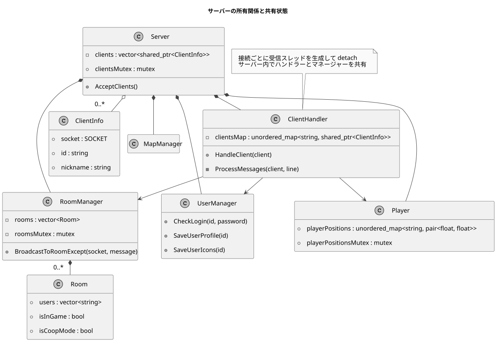
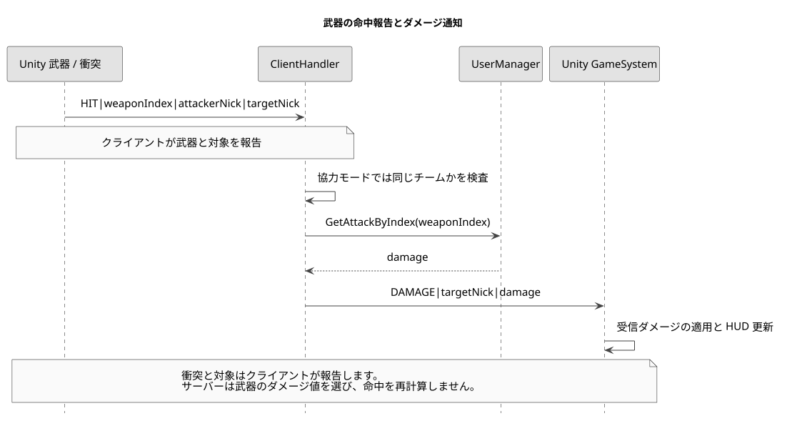
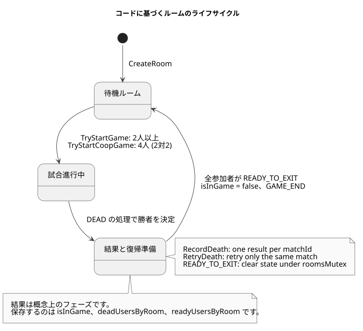
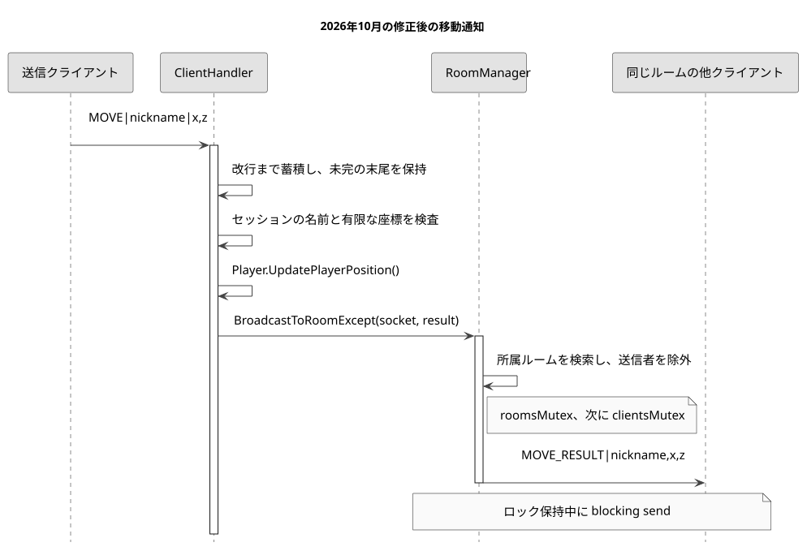
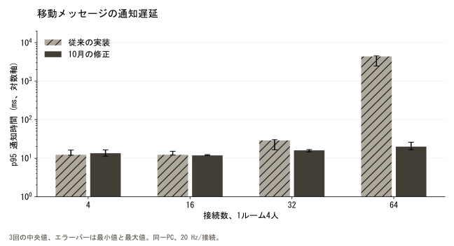
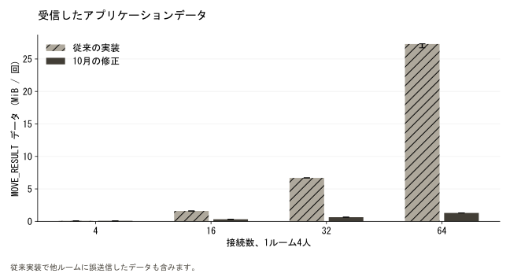
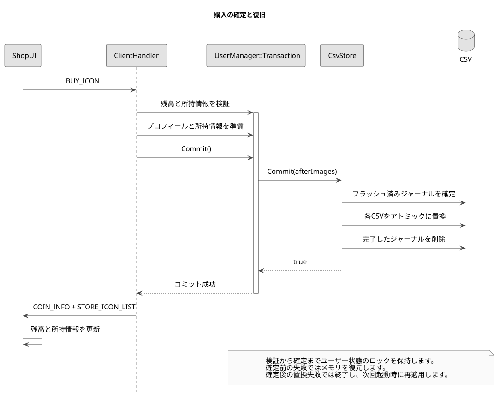

# Slap Squad / Engineering

[English](README.md), [한국어](README.ko.md), [日本語](README.ja.md)

2025年3月から2026年2月、プログラマー2名とグラフィック担当6名

C++サーバーとUnityの武器動作を実装し、移動、水風船の相互作用、試合結果、購入応答を連携させました。

2026年10月の追加作業: ルーム配信とTCPフレーミング修正、IOCP送信、起動時攻撃力キャッシュ、UML、再現可能な測定、プレイ映像。

## 同時購入の保存とルームの寿命を修正

32クライアントの同時購入で保存競合を再現しました。4種類のアイテム保存が同じtemp.csvを使い、別の要求の一時ファイルを上書き、削除していました。CSV形式を維持し、残高と所持情報を1回の購入単位で保存するように変更しました。

p95の中央値は3条件とも増加しました。64接続ではCPUの中央値が9.22%から7.65%に低下しましたが、8接続と32接続では増加しました。スレッド数は13、37、69のままです。期待した624,000件をすべて受信し、別ルームへの配信と重複はありませんでした。状態の整合性を修正した結果であり、全般的な遅延改善を示すものではありません。

[コードと測定データ](https://github.com/YSL-RyuDo/BnBServer/blob/main/docs/engineering/STATE_SAFETY.ja.md)

## 遅い受信者の分離を維持しながら送信スレッドを削減

64接続で、観測した最大スレッド数の中央値は132から69、サーバーCPUは論理コア1個基準で12.03%から7.34%に減少しました。最大RSSの中央値は16.03から14.49 MiBになりました。一方、p95の中央値は14.81から15.35 msに増えました。資源コストの削減であり、すべての応答が速くなったという結果ではありません。

| 接続数 | スレッド, 前 → 後 | CPU %, 前 → 後 | p95 ms, 前 → 後 | 最大RSS MiB, 前 → 後 |
| --- | --- | --- | --- | --- |
| 8 | 20 → 13 | 1.87 → 1.72 | 12.41 → 15.31 | 11.65 → 11.45 |
| 32 | 68 → 37 | 11.09 → 4.06 | 13.53 → 14.16 | 13.60 → 12.83 |
| 64 | 132 → 69 | 12.03 → 7.34 | 14.81 → 15.35 | 16.03 → 14.49 |

同一Windows機、Release x64、TCPループバック、1ルーム4人、各クライアント20 HzのMOVEです。接続数とバージョンごとに3回、準備2秒、測定10秒、受信待ち2秒を設定し、実行順を交互にしました。表は実行ごとの値の中央値で、p95も各実行のp95の中央値です。CPU 100%は論理コア1個です。参加者のいる待機ルームの配信経路を測定し、Unity描画、WAN、戦闘全体のシミュレーションは含みません。

GetAttackByIndexはHITごとにCharStat.csvを開いて解析していました。接続受付前に7件の攻撃力を検証して読み込み、その後は変更しないメモリ上のマップを参照します。不明なインデックスは従来どおり0です。不正な開始データでは読み込みが失敗し、ファイル変更の反映には再起動が必要です。起動時スナップショットという方針であり、ホットリロードやDB移行ではありません。

実際のUserManagerコードで10万回の参照を各版5回交互に実行し、全チェックサムが一致しました。ファイルキャッシュが温まった条件で、初期読み込みは除外しています。所要時間の中央値は9044.14 ms → 0.2805 msでした。ファイルの反復オープンと解析を小さなメモリマップ参照と比較したマイクロベンチマークで、ゲームやサーバー全体の同率の高速化を意味しません。

[実装と再現方法](https://github.com/YSL-RyuDo/BnBServer/blob/main/docs/engineering/IOCP.ja.md), [測定原資料](https://github.com/YSL-RyuDo/BnBServer/tree/main/docs/engineering/measurements/2026-10-21-iocp), [コード点検と残る作業](https://github.com/YSL-RyuDo/BnBServer/blob/main/docs/engineering/AUDIT.ja.md)


## 以前の修正: 遅い受信者の影響を分離

以前の段階の記録です。当時は接続ごとにblocking送信スレッドを設けました。現在の実装は上記のIOCP版で、旧測定値は変更履歴として保持します。

別室の1人が読み取りを停止した条件で、応答は変更前0/300件、変更後300/300件を3回とも確認しました。上限付きキュー、部分送信の直列化、接続の後処理を検証しました。

| 条件 / 指標 | 変更前、ルーム別blocking send | 変更後、上限付き送信キュー |
| --- | --- | --- |
| 読み取り停止、各回の別室への配信 | 0 / 300 | 300 / 300 |
| 読み取り停止、各回p95の中央値 | 定義不可、応答なし | 13.82 ms |
| 通常条件、各回の別室への配信 | 300 / 300 | 300 / 300 |
| 通常条件、各回p95の中央値 | 14.00 ms | 13.62 ms |
| 観測した最大スレッド数、8接続 | 12 | 20 |

[送信キューの設計と再現方法](https://github.com/YSL-RyuDo/BnBServer/blob/main/docs/engineering/OUTPUT_QUEUE.ja.md), [12回の生データとビルド根拠](https://github.com/YSL-RyuDo/BnBServer/tree/main/docs/engineering/measurements/2026-10-21-output-queue), [Git diff](https://github.com/YSL-RyuDo/BnBServer/compare/737a92c397adb4320cf439d99d148362ce1ca090...9e9110727ff5fa8c4cd016f9a55efe4aa93ecc4e)


## サーバーの所有関係と共有状態

ServerはClientHandlerとルーム、ユーザー、マップ、位置のマネージャーを所有します。AcceptClientsは接続ごとに受信スレッドを生成してdetachします。通信は改行区切りのテキストを使うblocking Winsock TCPです。

ルームの参照はロック内で作成する読み取り専用コピーに変更しました。チーム変更と死亡処理はRoomManagerのロック内で行い、勝敗の確定を試合ごとに1回に制限します。復帰準備が揃った時点で、同じロック内で状態を整理します。報酬の保存失敗時には試合番号を確認して確定を取り消し、再試行を可能にします。配信先の所有権を保持してルームと接続者のロックを解放した後、送信キューに追加します。



## 命中報告からルーム内のダメージ通知まで

Arrow、Laser、Mace、Melody、Pitchfork、Spell、Swordの動作と、WeaponSystemの装備選択、生成、クールダウンを実装しました。LocalPlayerControllerはUpdateの入力処理とFixedUpdateのRigidbody移動を分けます。攻撃情報には武器と座標を含め、レーザーではマップの障害物から計算した距離も送信します。

Unityの武器はHITで武器、攻撃者、対象を報告します。ClientHandlerは協力モードのチーム関係を検査し、GetAttackByIndexでダメージ値を取得してルームにDAMAGEを通知します。受信したGameSystemがダメージとHUDを更新します。サーバーが命中の衝突を再計算する構成ではありません。

ルーム構造を学び、実際のゲームで試すためにリーダー方式を採用しました。BalloonSystemでは時間が経過するとルームリーダーがREMOVE_BALLOONを送り、サーバーが水流の広がりを計算します。クライアントの衝突報告を信頼する部分は残っています。判定とタイミングをサーバーに移すには、サーバー側のワールド実装と予測、補正の検証が必要です。



## ルームのライフサイクル

待機、試合、結果からの復帰がルームUIとゲームをつなぎます。通常対戦は2人以上、協力モードは4人で2対2に分かれる必要があります。図の結果フェーズは概念上の区分です。コードではResults列挙型ではなく、isInGame、deadUsersByRoom、readyUsersByRoomを保持します。



## ルーム境界と配信範囲が一致していませんでした

従来のMOVE処理はBroadcastMessageExceptを呼び、送信者以外の全接続へ通知していました。4人ずつ16ルームに接続する64人条件では、本来3人に届くべき更新が最大63人に届きます。余分な負荷だけでなく、ルーム境界を破る動作でした。

10月の修正ではBroadcastToRoomExceptに切り替え、セッションの名前と有限な座標を検査しました。TCPの受信バイトを改行まで蓄積し、完成したメッセージだけを処理します。未完の末尾は次のrecvまで保持し、4,096バイトを超える行は拒否します。

最初の修正はテキストプロトコルとUnityのメッセージ形式を維持しました。長さを先頭に置くバイナリ形式には双方の変更が必要です。受信境界とルーム配信を先に修正し、その後に上記の送信キューを追加しました。



## 実際のTCPソケットによる確認

修正後はルーム分離、分割メッセージ、結合メッセージ、完成メッセージに続く未完の末尾、名前の偽装、不正な数値、非有限数、過大なフレームの8項目に合格しました。不正な数値の後にも正常な要求を送り、処理が継続することを確認しました。

従来版も結合メッセージは解析しましたが、別のルームに配信しました。検査は解析と受信先の両方を確認します。対象は受信境界とMOVE経路であり、アカウント、ショップ、戦闘の全コマンドを検証したものではありません。

## 実際のC++中継処理の性能評価

合成クライアント4、16、32、64接続を1ルーム4人に分け、各接続から毎秒20件のMOVEを送信しました。従来版と修正版を条件ごとに3回ずつ、順序を交互にして実行しました。各回は準備2秒、測定10秒、応答待ち2秒です。全24回をIntel Core i7-14700、RAM 31.69 GiB、Windowsビルド26200、Python 3.10.6でRelease x64として測定しました。

従来ソースは304b11b、修正ソースは737a92cです。同じビルド設定と合成データを使い、実験用ポートとloopbackへのバインドのみを変更しました。隔離したフォルダーに合成アカウントを作成します。

遅延は送信側の書き込み直前から別クライアントが応答の1行を受信するまでです。負荷生成器、TCP、OSのスケジューリングを含みます。参加者のいる待機ルームで実際のMOVE処理を測定しており、試合全体のシミュレーションやインターネット環境の同時接続上限ではありません。

| 接続 / ルーム | 従来 p95 | 修正 p95 | 従来 CPU | 修正 CPU | 修正後 未着 / 他ルーム |
| --- | --- | --- | --- | --- | --- |
| 4 / 1 | 12.22 ms | 13.42 ms | 1.09% | 1.09% | 0 / 0 |
| 16 / 4 | 12.22 ms | 11.78 ms | 7.82% | 2.81% | 0 / 0 |
| 32 / 8 | 28.77 ms | 15.90 ms | 42.95% | 5.77% | 0 / 0 |
| 64 / 16 | 4,381.75 ms | 19.91 ms | 99.10% | 17.94% | 0 / 0 |

各回で算出した値の3回の中央値。CPUの100%は論理コア1つです。未着と他ルームへの配信は修正版3回の合計です。





64接続でp95の中央値は4,381.75 msから19.91 msに変わりました。各回に受信したアプリケーションデータの中央値は27.30 MiBから1.30 MiBへ約95.2%減少しました。新しいネットワーク方式ではなく、更新1件の受信者を最大63人から3人に限定した結果です。

従来の64接続では、応答待ち終了時点で本来の配信がそれぞれ12、867、57件未着でした。従来版の遅延分位点は受信できた標本のみから算出しています。修正版は各回38,400件を全て受信し、他ルームへの配信は0件でした。修正版の全12回で未着、重複、形式エラー、他ルームへの配信はいずれも0件でした。

1ルームの4接続ではp95が12.22 msから13.42 msとなり、遅延改善は確認できませんでした。生成器とサーバーは同一PCを使用し、従来版64接続では生成器もほぼ1コアを使用しました。修正版の1回では生成スケジュールの遅れのp99が約21 msでした。この結果は過剰な配信先のコストを示しますが、サーバー内部の処理時間や本番環境の収容能力を証明するものではありません。

## CSV保存と購入結果の表示

当初はデータベースをまだ学んでいなかったため、実装を始めやすいCSVを選びました。後からDBへ変更する予定でしたが、移行を完了できませんでした。アカウント、プロフィール、所有アイテム、ショップ情報は現在もファイル保存です。

私のShopUI変更では、BuyItemが要求を送りボタンを無効にしても、selectedOwnedを即座にtrueにはしません。返されたアイテム情報は、そのタブが選択されている場合だけ表示に反映します。クリックだけで所有を確定させることや、別カテゴリの応答で現在のタブを更新することを避けています。

ユーザー状態のロック内で検証、メモリ更新、コミットを行います。CSVの更新後イメージをメモリにまとめ、復旧ジャーナルをフラッシュして確定してから各CSVを置換します。途中で終了した場合は、起動時にジャーナルを再適用してから接続を受け付けます。確定前の書き込み失敗ではメモリを戻します。確定後の置換失敗では記録を保持してプロセスを停止し、次回起動時に復旧します。同じデータディレクトリを別のサーバープロセスが開くこともファイルロックで防ぎます。

一時ファイル名の変更だけでは更新の消失や残高と所持情報の不一致が残ります。Roomをshared_ptrに変えるだけでも同時変更は保護できません。購入は1つのトランザクションにまとめ、ルームは一貫したコピーを読み取ります。MOVE処理はユーザー保存のロックを取得しません。



## 次に検証すること

アカウントの書き込みは1つのロックで直列化し、各トランザクションでユーザーベクトルをコピーして対象CSVを書き直します。既存形式と整合性を優先した設計で、高い書き込み処理能力を示す測定ではありません。ディスク破損や再起動後の試合復元は検証範囲外です。命中報告の独立したサーバー検証、プロセス全体の終了処理、Unityの割り当て計測は残っています。

## 実装から価格政策の研究へ

このゲームのアイテム価格を考えたことから、別のCNN消費パターンシミュレーション研究を始めました。I2P-CONで発表した後に改良し、CISC-W 2025のポスターとして発表しました。CNN推論をこのゲームサーバーに組み込んだわけではありません。

## コード、測定データ、再現方法

[Original 304b11b](https://github.com/YSL-RyuDo/BnBServer/tree/304b11b3c2bbd81ea702910b299ff6535806e34a), [October fix 737a92c](https://github.com/YSL-RyuDo/BnBServer/commit/737a92c397adb4320cf439d99d148362ce1ca090)

[生データと測定環境](measurements/2026-10-21/manifest.json), [24 runs](measurements/2026-10-21/results.json), [SHA-256](measurements/2026-10-21/sha256.json)

[Regression, original](measurements/2026-10-21/regression-baseline.json), [Regression, patched](measurements/2026-10-21/regression-candidate.json)

[Unity contribution and gameplay](https://ysl-ryudo.github.io/ja/work/bnb/#full-scope), [ShopUI change](https://github.com/YSL-RyuDo/BNB/commit/57cedd2e5c3b0dbbb7ea51b336602cc339630cea)

<a id="reproduction"></a>
## 実験の再現

```powershell
# Windows, Visual Studio 2022 Desktop development with C++, Python 3.10+
git clone https://github.com/YSL-RyuDo/BnBServer.git
cd BnBServer
python -m pip install -r tools/benchmark/requirements.txt
python tools/benchmark/build.py --ref 304b11b3c2bbd81ea702910b299ff6535806e34a --out .bench-work/baseline --port 39091
python tools/benchmark/build.py --ref 737a92c397adb4320cf439d99d148362ce1ca090 --out .bench-work/candidate --port 39092
python tools/benchmark/regression.py --build .bench-work/candidate --out .bench-work/regression
python tools/benchmark/compare.py --baseline .bench-work/baseline --candidate .bench-work/candidate --out .bench-work/comparison
```

遅延の生データは各実行の `samples.csv.gz` にあります。`summary.json` の分位点は実行ごとの最近接順位法です。`telemetry.json` はRSSとスレッド数を記録し、CPUは10秒の送信区間のプロセス時間差から計算します。RSSとスレッド数は応答待ち区間も含みます。集計対象は測定した要求への応答のみです。グラフは全標本を混ぜず、各回の分位点を要約します。エラーバーは信頼区間ではなく3回の最小値と最大値です。

```powershell
# Optional charts, matplotlib 3.10.5, numpy 2.2.6 used for this publication
python -m pip install matplotlib==3.10.5 numpy==2.2.6
python tools/benchmark/plot.py --results .bench-work/comparison/results.json --out .bench-work/charts
```

UMLはPlantUML 1.2026.9、Java 21、Smetanaレイアウトで生成しました。SVGと同じ場所に編集可能な `.puml` 原本があります。英語と韓国語はMalgun Gothic、日本語はMS Gothicを使用しています。

```powershell
java -Djava.awt.headless=true -jar plantuml.jar -charset UTF-8 -tsvg "docs/engineering/diagrams/*.puml"
```

PlantUML JAR SHA-256: `aa4a1d06f8911c4b842beff4828dd955be431692b631a312d04c0e9fab9581de`.
