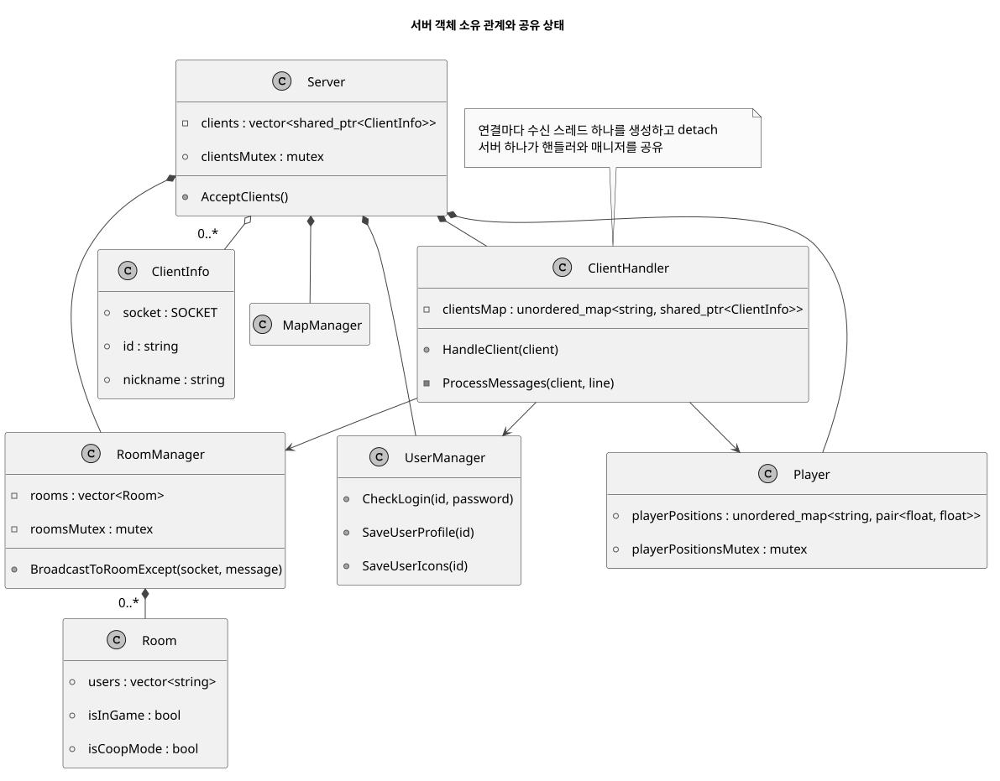
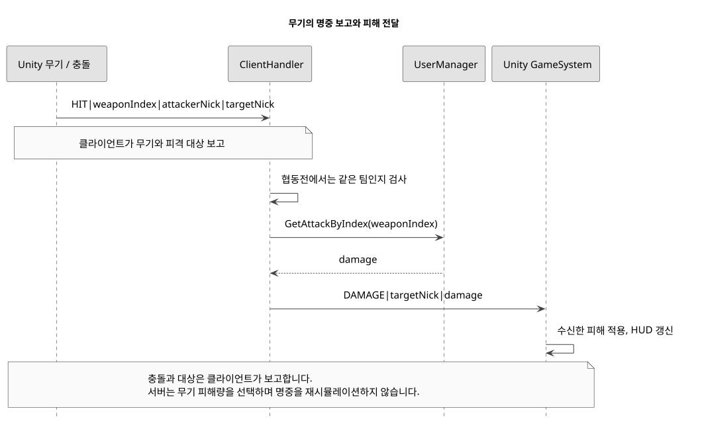
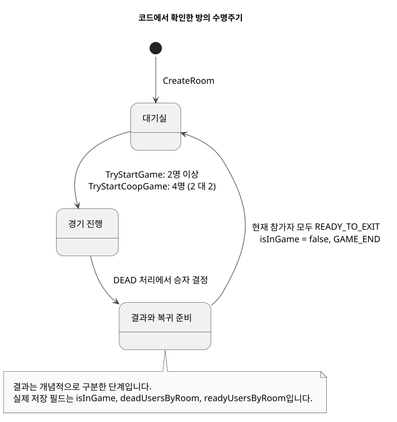
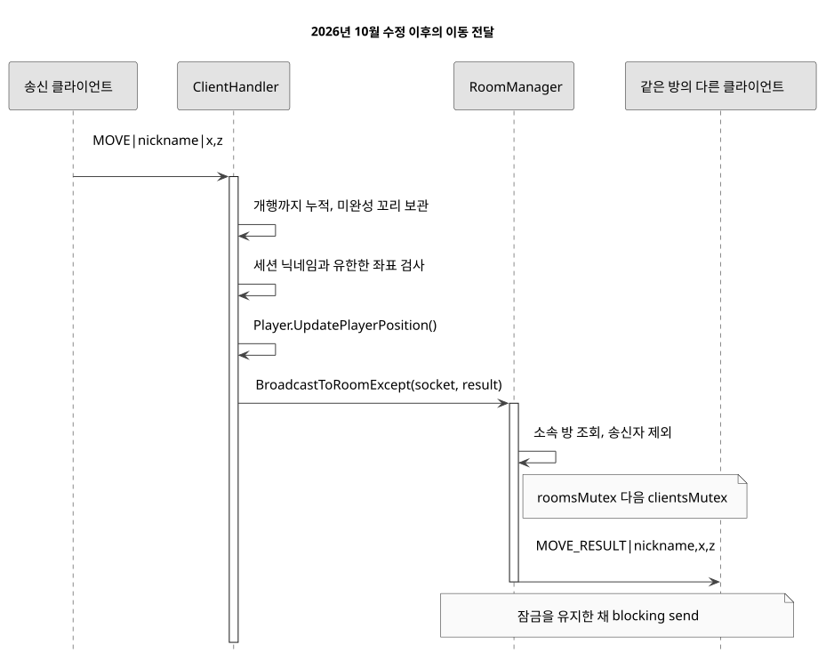
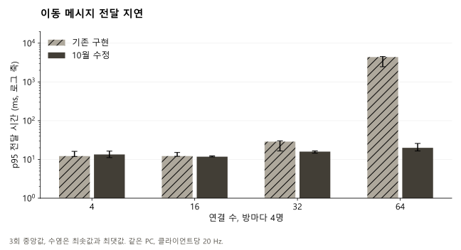
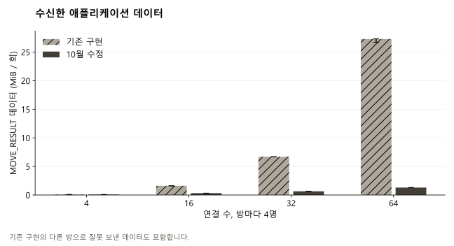
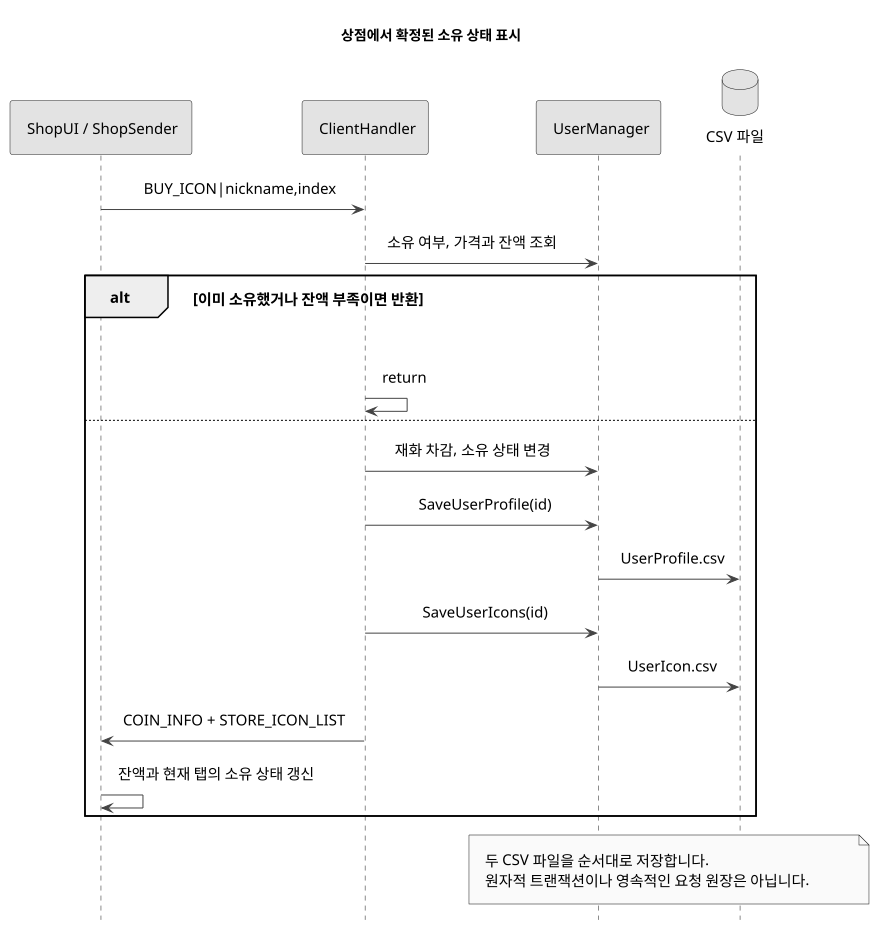

# Slap Squad / Engineering

[English](README.md), [한국어](README.ko.md), [日本語](README.ja.md)

2025년 3월부터 2026년 2월, 프로그래머 2명과 그래픽 팀원 6명

C++ 서버와 Unity 무기 동작을 구현하고 이동, 물풍선 상호작용, 경기 결과와 구매 응답을 연결했습니다.

2026년 10월 후속 작업: 방별 전달과 TCP 수신 경계 수정, IOCP 송신, 시작 공격력 캐시, UML과 재현 가능한 측정, 플레이 영상.

## 동시 구매 저장과 방 객체 수명 수정

32개 클라이언트의 동시 구매에서 저장 충돌을 재현했습니다. 네 종류의 아이템 저장 함수가 모두 temp.csv를 사용해 다른 요청의 임시 파일을 덮어쓰거나 삭제했습니다. 기존 CSV 형식을 유지하면서 재화 차감과 보유 목록을 한 번의 구매 단위로 저장하도록 고쳤습니다.

p95 중앙값은 세 조건 모두 늘었습니다. 64개 연결에서는 CPU 중앙값이 9.22%에서 7.65%로 줄었고, 8개와 32개에서는 늘었습니다. 스레드는 13, 37, 69개로 같았습니다. 기대한 전달 624,000건은 모두 도착했고 다른 방 전달과 중복은 없었습니다. 저장과 방 상태의 오류를 고친 결과이며, 전반적인 지연 개선을 입증한 결과는 아닙니다.

[코드와 측정 원자료](https://github.com/YSL-RyuDo/BnBServer/blob/main/docs/engineering/STATE_SAFETY.ko.md)

## 느린 수신자 격리를 유지하면서 송신 스레드 비용 줄이기

64개 연결에서 관찰한 최대 스레드 수의 중앙값은 132개에서 69개, 서버 CPU는 논리 코어 하나 기준 12.03%에서 7.34%로 줄었습니다. 최대 RSS의 중앙값은 16.03 MiB에서 14.49 MiB로 줄었습니다. 반면 p95 중앙값은 14.81 ms에서 15.35 ms로 늘었습니다. 자원 비용은 줄었지만 모든 응답이 빨라졌다는 결과는 아닙니다.

| 연결 수 | 스레드, 이전 → 이후 | CPU %, 이전 → 이후 | p95 ms, 이전 → 이후 | 최대 RSS MiB, 이전 → 이후 |
| --- | --- | --- | --- | --- |
| 8 | 20 → 13 | 1.87 → 1.72 | 12.41 → 15.31 | 11.65 → 11.45 |
| 32 | 68 → 37 | 11.09 → 4.06 | 13.53 → 14.16 | 13.60 → 12.83 |
| 64 | 132 → 69 | 12.03 → 7.34 | 14.81 → 15.35 | 16.03 → 14.49 |

같은 Windows 장비, Release x64, TCP 루프백에서 방마다 4명, 클라이언트마다 초당 MOVE 20회를 보냈습니다. 연결 수와 버전별로 3회 반복하고 준비 2초, 측정 10초, 수신 대기 2초를 적용했습니다. 버전 실행 순서는 번갈아 배치했습니다. 아래 값은 회차별 값의 중앙값이며 p95도 회차별 p95의 중앙값입니다. CPU 100%는 논리 코어 하나입니다. 참가자가 있는 대기실의 전달 경로를 측정했으며 Unity 렌더링, 인터넷 통신, 전체 전투 시뮬레이션은 포함하지 않습니다.

GetAttackByIndex는 HIT마다 CharStat.csv를 열고 파싱했습니다. 서버가 연결을 받기 전에 공격력 7개를 검증해 읽고, 이후에는 변경하지 않는 메모리 맵을 조회하도록 바꿨습니다. 없는 인덱스는 기존처럼 0을 반환합니다. 시작 데이터가 잘못되면 로딩에 실패하며, 파일 변경은 서버를 다시 시작해야 반영됩니다. 시작 시점의 설정을 유지하는 정책이며 핫 리로드나 DB 전환은 아닙니다.

실제 UserManager 코드에서 조회 10만 회를 버전별 5회씩 번갈아 실행했고 결과 체크섬은 모두 같았습니다. 파일 캐시가 준비된 조건이며 초기 로딩은 제외했습니다. 소요 시간 중앙값은 9044.14 ms → 0.2805 ms였습니다. 반복적인 파일 열기와 파싱을 작은 메모리 맵 조회와 비교한 결과입니다. 게임 전체나 서버 처리량이 같은 비율로 빨라졌다고 해석할 수 없습니다.

[구현과 재현 방법](https://github.com/YSL-RyuDo/BnBServer/blob/main/docs/engineering/IOCP.ko.md), [측정 원자료](https://github.com/YSL-RyuDo/BnBServer/tree/main/docs/engineering/measurements/2026-10-21-iocp), [코드 점검과 남은 작업](https://github.com/YSL-RyuDo/BnBServer/blob/main/docs/engineering/AUDIT.ko.md)


## 앞선 수정: 느린 수신자의 영향 분리

이전 단계의 기록입니다. 당시에는 연결마다 blocking 송신 스레드를 두었습니다. 현재 구현은 위의 IOCP 방식이며 이전 측정값은 변경 이력으로 보존합니다.

다른 방의 수신자 한 명이 읽기를 멈춘 조건에서 응답은 수정 전 0/300건, 수정 후 300/300건으로 3회 모두 확인했습니다. 크기를 제한한 큐, 부분 송신의 순차 처리, 연결 정리 검사를 추가했습니다.

| 조건 / 지표 | 이전, 방별 blocking send | 이후, 제한된 송신 큐 |
| --- | --- | --- |
| 읽기 중단, 회차별 정상 B방 내부 응답 | 0 / 300 | 300 / 300 |
| 읽기 중단, 회차별 p95의 중앙값 | 계산 불가, 수신 응답 없음 | 13.82 ms |
| 정상 조건, 회차별 정상 B방 내부 응답 | 300 / 300 | 300 / 300 |
| 정상 조건, 회차별 p95의 중앙값 | 14.00 ms | 13.62 ms |
| 관찰한 최대 스레드, 연결 8개 | 12 | 20 |

[송신 큐 설계와 재현 방법](https://github.com/YSL-RyuDo/BnBServer/blob/main/docs/engineering/OUTPUT_QUEUE.ko.md), [12회 원자료와 빌드 근거](https://github.com/YSL-RyuDo/BnBServer/tree/main/docs/engineering/measurements/2026-10-21-output-queue), [Git diff](https://github.com/YSL-RyuDo/BnBServer/compare/737a92c397adb4320cf439d99d148362ce1ca090...9e9110727ff5fa8c4cd016f9a55efe4aa93ecc4e)


## 서버 객체와 공유 상태

Server가 ClientHandler와 방, 사용자, 맵, 위치 매니저를 소유합니다. AcceptClients는 연결마다 수신 스레드를 하나씩 생성하고 detach합니다. 통신은 개행으로 메시지를 구분하는 blocking Winsock TCP입니다.

방 조회는 잠금 안에서 만든 읽기 전용 복사본을 반환합니다. 팀 변경과 사망 처리는 RoomManager 안에서 잠금을 잡고 수행하며, 경기별 승패 확정은 한 번만 허용합니다. 복귀 준비가 끝나면 같은 잠금 안에서 경기 상태를 정리합니다. 보상 저장에 실패하면 경기 번호를 확인한 뒤 재시도할 수 있도록 승패 확정을 되돌립니다. 방송은 수신자의 소유권을 확보한 뒤 방과 접속자 잠금을 풀고 송신 큐에 넣습니다.



## 무기의 명중 보고가 방 안의 피해로 전달되기까지

Arrow, Laser, Mace, Melody, Pitchfork, Spell, Sword의 동작과 WeaponSystem의 장비 선택, 생성, 쿨다운 경로를 구현했습니다. LocalPlayerController는 Update의 입력 처리와 FixedUpdate의 Rigidbody 이동을 나눕니다. 공격 메시지는 무기와 위치 정보를 전달하며, 레이저는 맵 장애물로 계산한 거리도 전달합니다.

Unity 무기가 HIT에 무기, 공격자, 대상을 실어 보냅니다. ClientHandler는 협동전의 팀 관계를 검사하고 GetAttackByIndex로 피해량을 가져와 방에 DAMAGE를 전달합니다. 수신한 GameSystem이 피해와 HUD를 갱신합니다. 명중 충돌 자체를 서버에서 다시 계산하는 구조는 아닙니다.

룸 리더 방식은 방 구조를 공부하면서 실제 게임에도 적용해보고 싶어 시도했습니다. BalloonSystem에서는 시간이 지나면 룸 리더가 REMOVE_BALLOON을 보내고 서버가 물줄기의 확산을 계산합니다. 클라이언트의 충돌 보고를 신뢰하는 부분은 남아 있습니다. 판정과 타이밍까지 서버로 옮기려면 서버 측 월드 구현과 예측, 보정에 대한 별도 검증이 필요합니다.



## 방의 수명주기

대기실, 경기, 결과 후 복귀가 방 UI와 게임을 연결합니다. 일반전은 2명 이상, 협동전은 4명이 2 대 2로 나뉘어야 시작합니다. 아래의 결과 단계는 개념적인 구분입니다. 실제 코드는 Results 열거형 대신 isInGame, deadUsersByRoom, readyUsersByRoom을 저장합니다.



## 방은 나뉘어 있었지만 이동 전달은 나뉘지 않았습니다

기존 MOVE 처리는 BroadcastMessageExcept를 호출해 송신자를 제외한 모든 연결에 전달했습니다. 4명씩 16개 방에 접속한 64명 조건에서는 실제 수신 대상 3명 대신 최대 63명에게 이동이 전달됩니다. 불필요한 부하이면서 방의 경계를 어기는 동작이었습니다.

10월 수정에서는 BroadcastToRoomExcept로 전달 범위를 바꾸고 세션 닉네임과 유한한 좌표를 검사했습니다. TCP 수신 바이트를 개행까지 누적해 완성된 메시지만 처리하고, 미완성 꼬리는 다음 recv까지 보관합니다. 4,096바이트를 넘는 메시지는 거부합니다.

첫 수정은 텍스트 프로토콜을 유지해 Unity 메시지 형식을 바꾸지 않았습니다. 길이를 앞에 넣는 이진 프로토콜은 클라이언트와 서버를 함께 바꿔야 합니다. 수신 경계와 방별 전달을 먼저 고친 뒤, 위의 송신 큐를 추가했습니다.



## 실제 TCP 소켓으로 확인한 동작

수정한 서버에서 방 격리, 분할 메시지, 합쳐진 메시지, 완성 메시지 뒤의 미완성 꼬리, 닉네임 위조, 잘못된 숫자, 비유한 숫자, 과대 메시지의 8가지 회귀 검사를 통과했습니다. 잘못된 숫자 뒤에는 정상 메시지를 추가로 보내 처리가 계속되는지도 확인했습니다.

기존 버전도 합쳐진 메시지는 파싱했지만 다른 방에 전달했습니다. 검사는 파싱과 수신 대상을 함께 확인합니다. 이 결과의 범위는 수신 경계와 MOVE 경로이며 계정, 상점, 전투 명령 전체에 대한 검증은 아닙니다.

## 실제 C++ 이동 전달 경로의 성능 평가

합성 클라이언트 4, 16, 32, 64개를 방마다 4개씩 연결하고 클라이언트마다 초당 MOVE 20개를 보냈습니다. 각 조건을 기존, 수정 버전별로 3회씩 순서를 번갈아 실행했습니다. 매회 준비 2초, 측정 10초, 남은 응답 대기 2초입니다. 총 24회이며 Intel Core i7-14700, RAM 31.69 GiB, Windows 빌드 26200, Python 3.10.6에서 Release x64로 측정했습니다.

기존 소스는 304b11b, 수정 소스는 737a92c입니다. 같은 빌드 설정과 합성 데이터를 사용하고 실험용 포트와 loopback 바인딩만 변경했습니다. 별도 폴더에서 합성 계정을 생성해 실행합니다.

지연 시간은 송신 클라이언트가 쓰기 직전부터 다른 클라이언트가 응답 한 줄을 모두 받을 때까지입니다. 부하 생성기, TCP, 운영체제 스케줄링을 포함합니다. 참가자가 들어 있는 대기실에서 실제 MOVE 처리를 측정했으며, 전체 경기 시뮬레이션이나 인터넷 환경의 동접 한계를 측정한 것은 아닙니다.

| 연결 / 방 | 기존 p95 | 수정 p95 | 기존 CPU | 수정 CPU | 수정 후 누락 / 다른 방 |
| --- | --- | --- | --- | --- | --- |
| 4 / 1 | 12.22 ms | 13.42 ms | 1.09% | 1.09% | 0 / 0 |
| 16 / 4 | 12.22 ms | 11.78 ms | 7.82% | 2.81% | 0 / 0 |
| 32 / 8 | 28.77 ms | 15.90 ms | 42.95% | 5.77% | 0 / 0 |
| 64 / 16 | 4,381.75 ms | 19.91 ms | 99.10% | 17.94% | 0 / 0 |

각 실행에서 계산한 값의 3회 중앙값입니다. CPU 100%는 논리 코어 하나입니다. 누락과 다른 방 전달은 수정 버전 3회 합계입니다.





64개 연결에서 p95의 중앙값은 4,381.75 ms에서 19.91 ms로 바뀌었습니다. 매회 수신한 애플리케이션 데이터의 중앙값은 27.30 MiB에서 1.30 MiB로 약 95.2% 줄었습니다. 네트워크 방식을 교체한 효과가 아니라 이동 하나의 수신 대상을 최대 63명에서 3명으로 제한한 결과입니다.

기존 64개 연결 실험에서는 응답 대기 종료 시점에도 의도한 전달 중 12, 867, 57개가 각각 도착하지 않았습니다. 기존 버전의 지연 백분위는 도착한 표본만으로 계산했습니다. 수정 버전은 매회 38,400개를 모두 받았고 다른 방 전달은 0개였습니다. 수정 버전의 전체 부하 실험 12회에서 누락, 중복, 형식 오류와 다른 방 전달이 모두 0개였습니다.

방이 하나인 4개 연결에서는 p95가 12.22 ms에서 13.42 ms로 바뀌어 지연 개선을 확인하지 못했습니다. 부하 생성기와 서버가 같은 PC를 사용하며, 기존 64개 연결 실험에서 생성기 CPU도 코어 하나에 가까웠습니다. 수정 버전 한 회의 생성 스케줄 지연 p99도 약 21 ms였습니다. 이번 결과는 이 환경에서 과도한 전송 대상이 만드는 비용을 보여주며 서버 내부 처리 시간이나 실제 서비스 수용량을 증명하지는 않습니다.

## CSV 저장과 구매 결과 표시

처음에는 DB를 배우기 전이라 쉽게 구현을 시작할 수 있는 CSV를 선택했습니다. 나중에 DB로 바꾸려고 했지만 전환을 완료하지 못했습니다. 현재 계정, 프로필, 소유 아이템과 상점 정보는 파일에 저장됩니다.

제가 수정한 ShopUI에서는 BuyItem이 요청을 보내고 버튼을 비활성화하되 selectedOwned를 즉시 true로 바꾸지 않습니다. 반환된 아이템 정보는 해당 탭이 선택된 경우에만 화면을 갱신합니다. 클릭만으로 소유가 확정된 것처럼 보이거나 다른 카테고리의 응답으로 현재 탭이 바뀌는 문제를 피합니다.

사용자 상태 잠금을 잡은 상태에서 구매 조건 확인, 메모리 변경, 저장을 처리합니다. 변경할 CSV 내용을 메모리에 모으고, 복구 기록을 디스크에 기록한 뒤 각 CSV를 교체합니다. 중간에 종료되면 다음 시작 때 복구 기록을 재적용하고 나서 접속을 받습니다. 복구 기록을 확정하기 전의 쓰기 실패는 메모리를 되돌립니다. 확정 뒤 파일 교체에 실패하면 기록을 남기고 서버를 종료해 다음 시작 때 복구합니다. 같은 데이터 폴더를 두 서버가 동시에 열 수 없도록 파일 잠금도 둡니다.

임시 파일명만 바꾸면 동시 변경 유실과 재화, 보유 목록의 불일치가 남습니다. 방을 shared_ptr로만 바꾸어도 삭제 이후 접근은 막을 수 있지만 동시 변경은 보호하지 못합니다. 구매는 하나의 트랜잭션으로 묶고, 방 조회는 일관된 복사본을 읽는 방식으로 정리했습니다. MOVE 처리는 사용자 저장 잠금을 거치지 않습니다.



## 다음에 확인할 문제

계정 쓰기는 하나의 사용자 잠금으로 직렬화하며, 트랜잭션마다 사용자 벡터를 복사하고 변경한 CSV를 다시 씁니다. 기존 형식과 저장 일관성을 유지하는 선택이며 높은 쓰기 처리량을 입증한 결과는 없습니다. 디스크 손상 복구와 재시작 후 진행 중 경기 복원도 검증 범위에 포함되지 않습니다. 클라이언트가 보고하는 명중의 서버 검증, 서버 전체 종료, Unity 할당량 측정은 남아 있습니다.

## 구현에서 가격정책 연구로

이 게임의 아이템 가격을 고민하면서 별도의 CNN 소비 패턴 시뮬레이션 연구를 진행했습니다. I2P-CON에서 발표한 뒤 보완해 CISC-W 2025 포스터로 발표했습니다. CNN 추론을 이 게임 서버에 배포한 것은 아닙니다.

## 코드, 실험 데이터와 재현 방법

[Original 304b11b](https://github.com/YSL-RyuDo/BnBServer/tree/304b11b3c2bbd81ea702910b299ff6535806e34a), [October fix 737a92c](https://github.com/YSL-RyuDo/BnBServer/commit/737a92c397adb4320cf439d99d148362ce1ca090)

[원자료와 측정 환경](measurements/2026-10-21/manifest.json), [24 runs](measurements/2026-10-21/results.json), [SHA-256](measurements/2026-10-21/sha256.json)

[Regression, original](measurements/2026-10-21/regression-baseline.json), [Regression, patched](measurements/2026-10-21/regression-candidate.json)

[Unity contribution and gameplay](https://ysl-ryudo.github.io/ko/work/bnb/#full-scope), [ShopUI change](https://github.com/YSL-RyuDo/BNB/commit/57cedd2e5c3b0dbbb7ea51b336602cc339630cea)

<a id="reproduction"></a>
## 실험 재현

```powershell
# Windows, Visual Studio 2022 Desktop development with C++, Python 3.10+
git clone https://github.com/YSL-RyuDo/BnBServer.git
cd BnBServer
python -m pip install -r tools/benchmark/requirements.txt
python tools/benchmark/build.py --ref 304b11b3c2bbd81ea702910b299ff6535806e34a --out .bench-work/baseline --port 39091
python tools/benchmark/build.py --ref 737a92c397adb4320cf439d99d148362ce1ca090 --out .bench-work/candidate --port 39092
python tools/benchmark/regression.py --build .bench-work/candidate --out .bench-work/regression
python tools/benchmark/compare.py --baseline .bench-work/baseline --candidate .bench-work/candidate --out .bench-work/comparison
```

실행별 원시 지연 표본은 `samples.csv.gz`에 있습니다. `summary.json`의 백분위는 실행별 최근접 순위 방식입니다. `telemetry.json`은 RSS와 스레드 표본을 기록하며 CPU는 10초 송신 구간의 프로세스 시간 차이로 계산합니다. RSS와 스레드는 응답 대기 구간까지 포함합니다. 집계는 측정 구간 요청에 대한 응답만 포함합니다. 그래프는 표본을 합치지 않고 실행별 백분위를 요약하며, 오차 막대는 신뢰구간이 아닌 3회 최솟값과 최댓값입니다.

```powershell
# Optional charts, matplotlib 3.10.5, numpy 2.2.6 used for this publication
python -m pip install matplotlib==3.10.5 numpy==2.2.6
python tools/benchmark/plot.py --results .bench-work/comparison/results.json --out .bench-work/charts
```

UML은 PlantUML 1.2026.9, Java 21, Smetana 레이아웃으로 생성했습니다. SVG 옆에 수정 가능한 `.puml` 원본이 있습니다. 영어와 한국어는 Malgun Gothic, 일본어는 MS Gothic 글꼴입니다.

```powershell
java -Djava.awt.headless=true -jar plantuml.jar -charset UTF-8 -tsvg "docs/engineering/diagrams/*.puml"
```

PlantUML JAR SHA-256: `aa4a1d06f8911c4b842beff4828dd955be431692b631a312d04c0e9fab9581de`.
