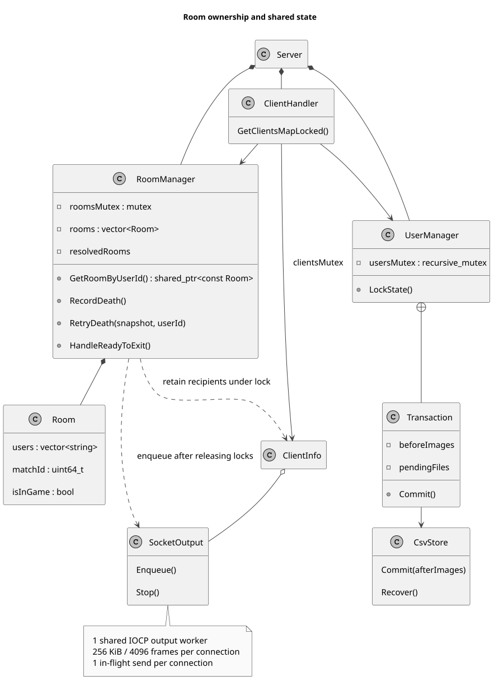
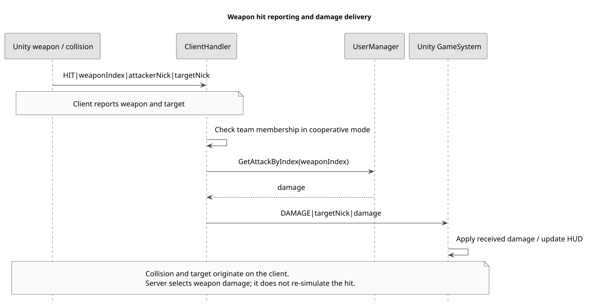
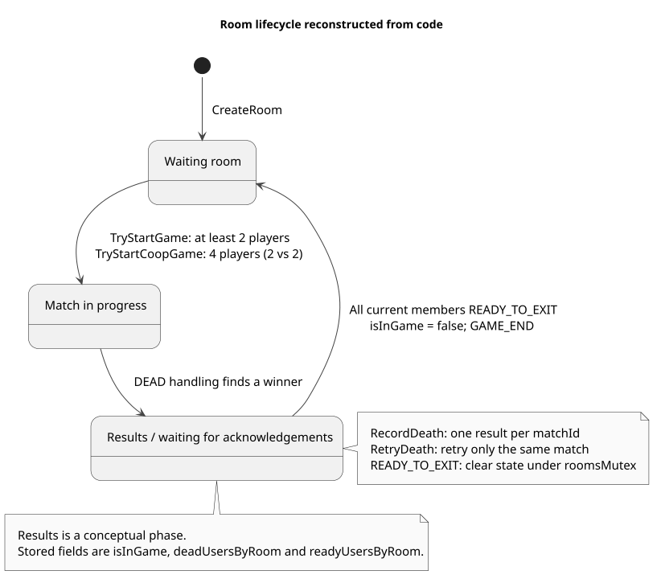
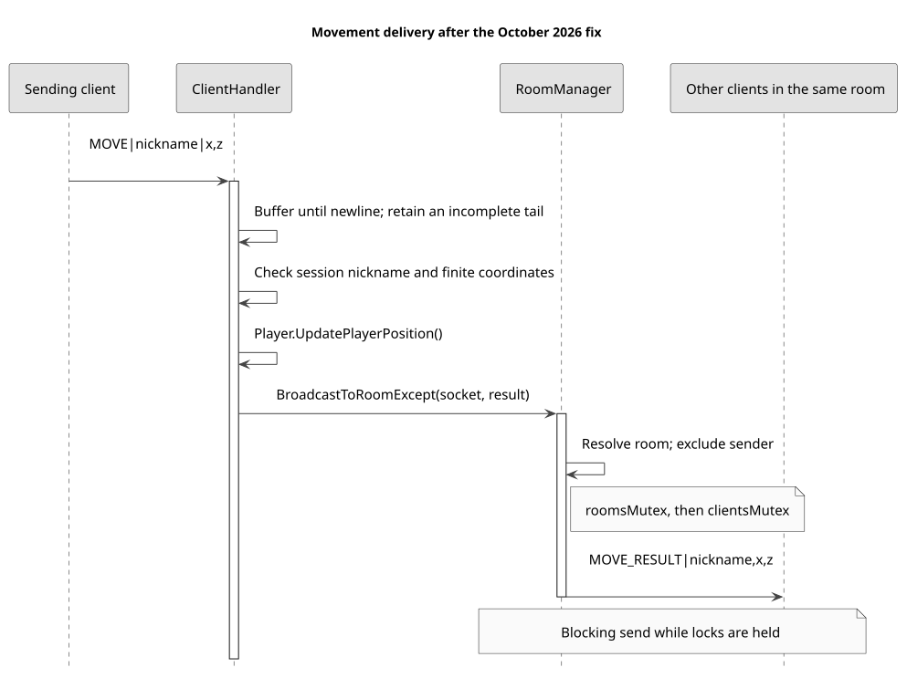
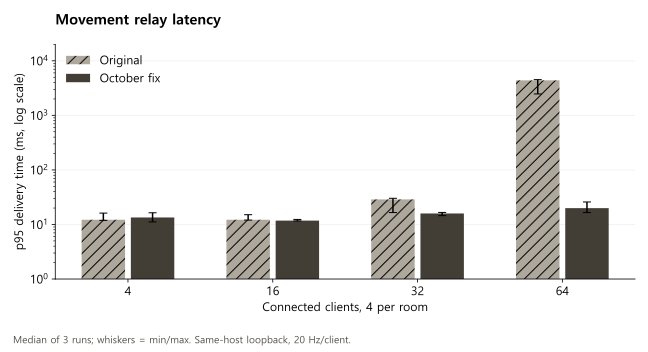
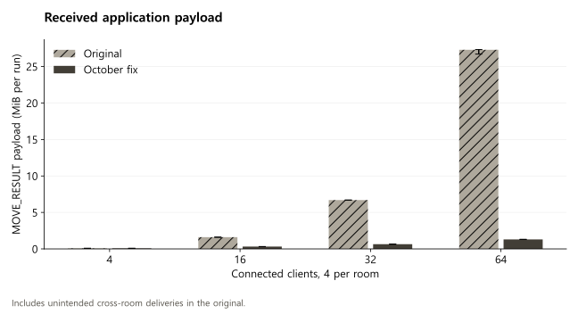
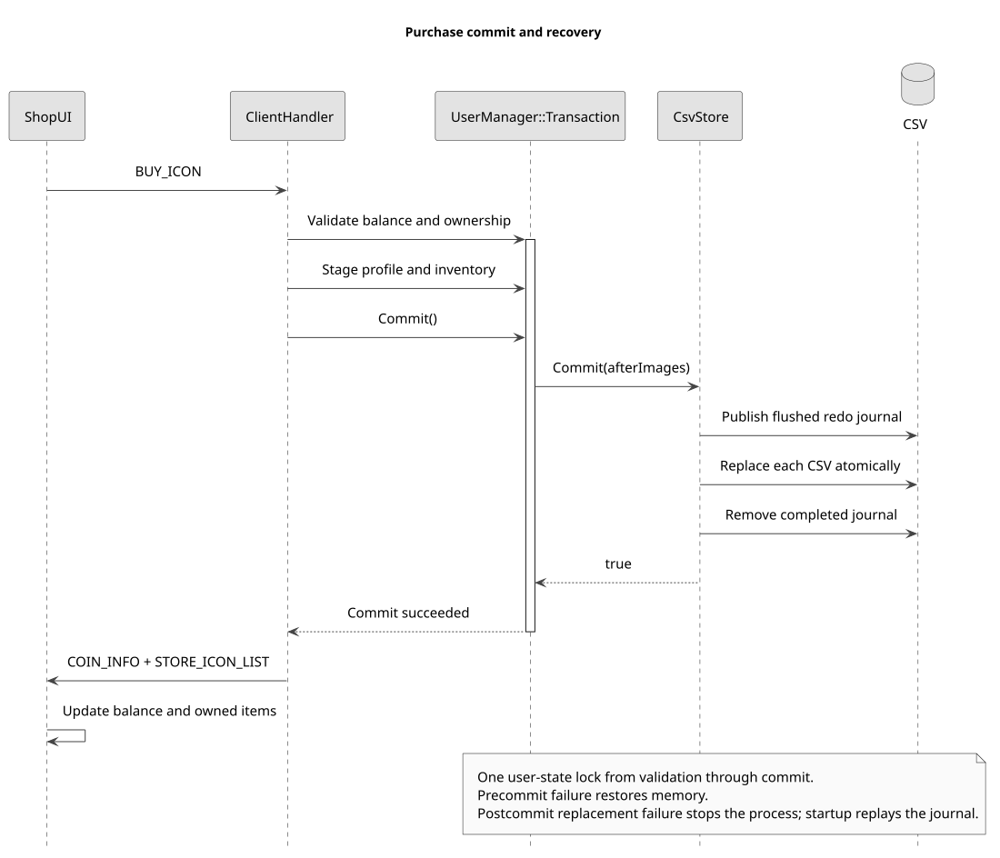

# Slap Squad, Engineering evidence

[English](README.md), [한국어](README.ko.md), [日本語](README.ja.md)

March 2025 to February 2026, 2 programmers and 6 graphics team members

I implemented the C++ server and Unity weapon behaviors, and connected movement, balloon interactions, match results and purchase feedback.

October 2026 follow-up: source audit, TCP framing and room isolation fixes, UML and reproducible measurements.

## The server and its shared state

Server owns a shared ClientHandler and the room, user, map and position managers. AcceptClients creates a detached receive thread for each connection. The protocol is newline-delimited text over blocking Winsock TCP.

This made it possible to connect login, rooms, matches and the shop in one process. It also means a slow send can hold a shared lock and delay other rooms. The diagram shows the implemented classes, rather than a proposed IOCP or database architecture.



## A reported hit becomes damage in the room

I implemented Arrow, Laser, Mace, Melody, Pitchfork, Spell and Sword behaviors, plus the WeaponSystem path for equipment, spawning and cooldowns. LocalPlayerController separates input sampling in Update from Rigidbody movement in FixedUpdate. Network attack data carries the selected weapon and transform; the laser path also supplies an obstacle-based distance.

A Unity weapon reports HIT with the weapon, attacker and target. ClientHandler checks team membership in cooperative mode, selects damage through GetAttackByIndex and delivers DAMAGE to the room. The receiving GameSystem applies that damage and updates the HUD. The server does not independently replay the collision.

I tried the room-leader approach while learning how rooms work and applying it to an actual game. In BalloonSystem, the room leader sends REMOVE_BALLOON when the timer expires; the server computes the water spread. Client collision reporting still forms part of the trust boundary. Moving collision and timing decisions to the server would require server-side world simulation and separate validation of prediction and correction.



## Room lifecycle

Waiting, playing and returning from results connect the room UI to the match. The normal start requires at least two players. Cooperative play requires four players split two against two. The result phase below is conceptual: the code stores isInGame, deadUsersByRoom and readyUsersByRoom, not a Results enum.



## The room boundary was not the delivery boundary

The original MOVE handler called BroadcastMessageExcept, which sent to every connected client except the sender. With 64 clients in 16 four-player rooms, each move could reach 63 clients although only three were intended recipients. This was a correctness bug as well as unnecessary work.

The October patch calls BroadcastToRoomExcept, checks the session nickname and finite coordinates, and buffers incoming TCP bytes until a complete newline-delimited message is available. A trailing partial message waits for the next recv. Lines over 4,096 bytes are rejected.

Keeping the text protocol avoided changing the Unity message format. A length-prefixed binary protocol is another option, but would require coordinated client changes. The current patch addresses framing and MOVE delivery; it does not replace the connection-thread model or implement per-client send queues.



## Checks against real TCP sockets

Eight regression scenarios pass on the patched server: room isolation, a split message, several coalesced messages, a complete message followed by a partial one, a forged nickname, an invalid number, a non-finite number and an oversized frame. Invalid-number checks also send a subsequent valid message to verify continued progress.

The baseline also parsed coalesced messages, but delivered them outside the room. The regression assertions check both parsing and recipients. The tests cover this receive and MOVE path, not every account, shop or combat command.

## Performance measured on the actual C++ relay

4, 16, 32 and 64 synthetic connections, four clients per room, 20 MOVE requests per second per client. Each variant ran three times with alternating order, two seconds of warm-up, ten seconds of measurement and two seconds to drain responses. The 24 runs use Release x64 builds on an Intel Core i7-14700 with 31.69 GiB RAM, Windows build 26200 and Python 3.10.6.

The baseline is 304b11b; the patched source is 737a92c. Both use the same fixture and build settings. The harness only changes the listening port and binds the test server to loopback. It creates synthetic accounts in an isolated directory.

Latency is measured from immediately before the sender writes a request until another client receives the complete response line. It includes the load generator, TCP and OS scheduling. These are populated waiting rooms exercising the actual MOVE handler, not full game simulations or an Internet concurrency limit.

| Clients / rooms | Original p95 | Patched p95 | Original CPU | Patched CPU | Patched missing / cross-room |
| --- | --- | --- | --- | --- | --- |
| 4 / 1 | 12.22 ms | 13.42 ms | 1.09% | 1.09% | 0 / 0 |
| 16 / 4 | 12.22 ms | 11.78 ms | 7.82% | 2.81% | 0 / 0 |
| 32 / 8 | 28.77 ms | 15.90 ms | 42.95% | 5.77% | 0 / 0 |
| 64 / 16 | 4,381.75 ms | 19.91 ms | 99.10% | 17.94% | 0 / 0 |

Median of three per-run values. CPU: 100% equals one logical core. Missing and cross-room counts are totals across all three patched runs.





At 64 connections, median p95 changed from 4,381.75 ms to 19.91 ms. Received application payload changed from 27.30 MiB to 1.30 MiB per run, approximately 95.2% less. This is explained by restricting each update from up to 63 recipients to three, not by a new network stack.

The original 64-client runs had 12, 867 and 57 intended deliveries still missing after the drain window. Its reported latency percentiles cover received samples only. The patched runs received all 38,400 intended deliveries per run, with no cross-room deliveries. All 12 patched load runs had zero missing, duplicate, malformed or cross-room responses.

With only one room, p95 was 12.22 ms before and 13.42 ms after: this experiment does not show a latency improvement at that load. The generator shares the machine; at 64 connections its baseline CPU approached one core, and patched scheduling lag p99 reached about 21 ms in one run. The large-load result demonstrates the cost of excess fan-out in this setup. It does not isolate server processing time or establish production capacity.

## CSV persistence and confirmed purchase feedback

I chose CSV because it was easy to start with before I had learned databases. I planned to replace it later but did not complete that migration. Account, profile, ownership and shop data therefore remain file-backed.

In my ShopUI change, BuyItem sends the request and disables the button without immediately setting selectedOwned to true. Returned item data refreshes the relevant tab only when that tab is selected. This avoids turning a click into confirmed ownership and keeps a response for one category from replacing another category’s visible content.

For BUY_ICON, the server checks ownership, price and balance, updates memory, then saves the profile and icon files separately. It returns the balance and item list afterward. Those writes are not one atomic transaction, and the handler does not act on their boolean save results. Waiting for returned ownership improves UI correctness but does not guarantee crash-safe persistence.

A database migration would need to commit debit and ownership together, define retry identity and handle save failure. Optimistic UI would additionally require rollback. Those are follow-up designs, not completed features of this game.



## What I would test next

The measured fix keeps blocking send inside shared locks. The next networking experiment is a per-client bounded output queue, tested with a slow reader and concurrent room transitions. The current harness stops the isolated process before closing clients, so it does not validate graceful shutdown or reconnect behavior.

For persistence, the next checks are concurrent purchases and a forced interruption between the two writes. For gameplay authority, client-reported hits and water damage need independent server validation. These are separate failure modes from MOVE fan-out and need separate experiments.

## From implementation to a pricing question

Deciding prices for this game motivated my separate CNN consumption-pattern simulation. I presented the research at I2P-CON, then refined it for the CISC-W 2025 poster. The CNN study is not deployed inference in this game server.

## Source, test data and reproduction

[Original 304b11b](https://github.com/YSL-RyuDo/BnBServer/tree/304b11b3c2bbd81ea702910b299ff6535806e34a), [October fix 737a92c](https://github.com/YSL-RyuDo/BnBServer/commit/737a92c397adb4320cf439d99d148362ce1ca090)

[Raw measurements and environment](measurements/2026-10-21/manifest.json), [24 runs](measurements/2026-10-21/results.json), [SHA-256](measurements/2026-10-21/sha256.json)

[Regression, original](measurements/2026-10-21/regression-baseline.json), [Regression, patched](measurements/2026-10-21/regression-candidate.json)

[Unity contribution and gameplay](https://ysl-ryudo.github.io/en/work/bnb/#full-scope), [ShopUI change](https://github.com/YSL-RyuDo/BNB/commit/57cedd2e5c3b0dbbb7ea51b336602cc339630cea)

<a id="reproduction"></a>
## Reproduce the experiment

```powershell
# Windows, Visual Studio 2022 Desktop development with C++, Python 3.10+
git clone https://github.com/YSL-RyuDo/BnBServer.git
cd BnBServer
python -m pip install -r tools/benchmark/requirements.txt
python tools/benchmark/build.py --ref 304b11b3c2bbd81ea702910b299ff6535806e34a --out .bench-work/baseline --port 39091
python tools/benchmark/build.py --ref 737a92c397adb4320cf439d99d148362ce1ca090 --out .bench-work/candidate --port 39092
python tools/benchmark/regression.py --build .bench-work/candidate --out .bench-work/regression
python tools/benchmark/compare.py --baseline .bench-work/baseline --candidate .bench-work/candidate --out .bench-work/comparison
```

Raw latency samples are in each run's `samples.csv.gz`. `summary.json` contains nearest-rank per-run percentiles. `telemetry.json` records RSS and thread samples; CPU uses process-time deltas over the 10-second sending phase. RSS and threads include the drain window. Counters include only responses to measured requests. The charts summarize run quantiles rather than pooling the samples. Error bars show the minimum and maximum of three runs, not confidence intervals.

```powershell
# Optional charts, matplotlib 3.10.5, numpy 2.2.6 used for this publication
python -m pip install matplotlib==3.10.5 numpy==2.2.6
python tools/benchmark/plot.py --results .bench-work/comparison/results.json --out .bench-work/charts
```

Diagrams: PlantUML 1.2026.9, Java 21, Smetana layout. Editable `.puml` files are beside the SVGs. Fonts: Malgun Gothic for English/Korean, MS Gothic for Japanese.

```powershell
java -Djava.awt.headless=true -jar plantuml.jar -charset UTF-8 -tsvg "docs/engineering/diagrams/*.puml"
```

PlantUML JAR SHA-256: `aa4a1d06f8911c4b842beff4828dd955be431692b631a312d04c0e9fab9581de`.
